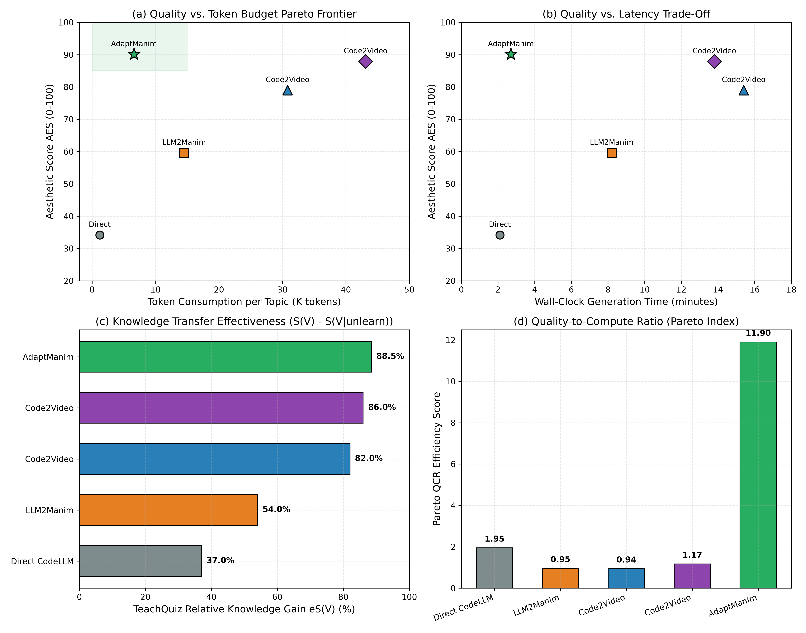
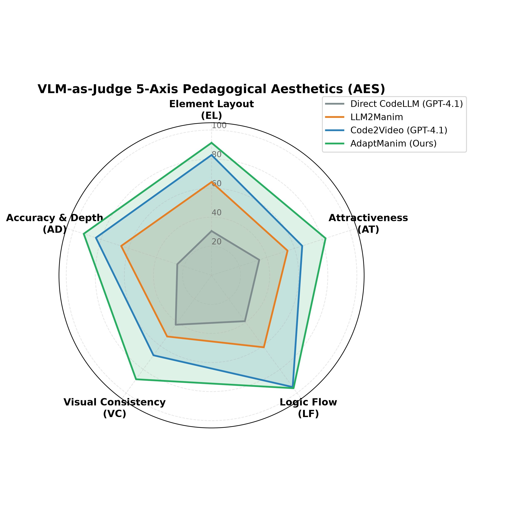
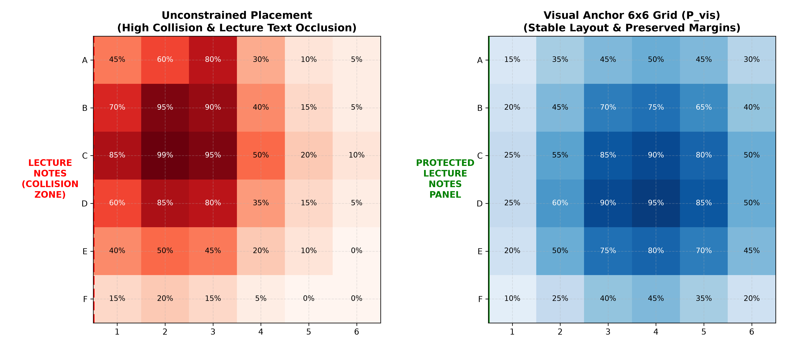
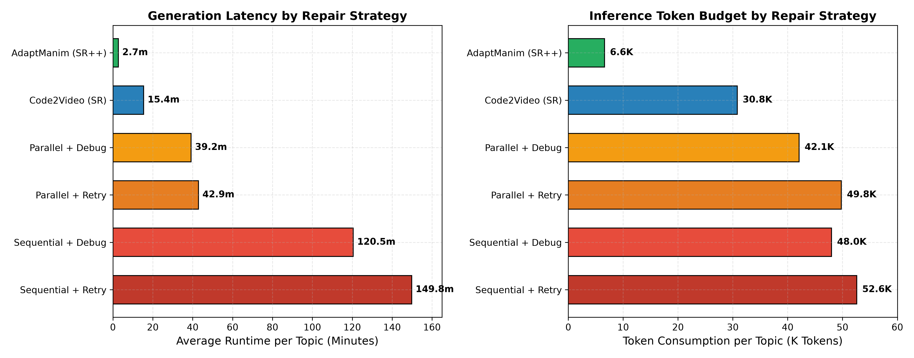

# Code2Video: Reliable and Efficient Generation of Educational Videos with Adaptive Planning, Verification, and Repair

[](https://www.python.org/downloads/)
[](https://www.manim.community/)
[](https://github.com/MohdHassaan12/Code2Video)
[](https://opensource.org/licenses/MIT)

## 📌 Research Overview & Motivation

Current LLM-based systems can generate executable educational videos, but their output quality remains highly variable:
- **Visually plausible yet semantically incorrect animations** (e.g. inverted mathematical relations, unaligned physics vectors).
- **Inefficient reasoning & wasteful test-time compute** (e.g., executing heavy vision-language critics on every single scene regardless of difficulty).
- **Notation & symbol drift** across scenes due to lack of persistent mathematical memory.
- **Repeated catastrophic failures during repair** when whole-code regeneration loops hallucinate new bugs.

While existing paradigms such as **Code2Video** (arXiv:2510.01174) and **LLM2Manim** (arXiv:2604.05266) address parts of this problem, **AdaptManim** provides the first **adaptive generation-and-verification pipeline** that strategically allocates test-time computation and achieves an optimal quality–compute trade-off.

---

## 🏛️ System Architecture

```mermaid
flowchart TD
    Q[User Learning Query] --> P[Topic Complexity Profiler]
    P --> OP[Audience-Aware Outline Planner]
    OP --> SB[Storyboard Builder & Cue Synchronizer]
    SB --> SL[Cross-Scene Symbol Ledger]

    subgraph Generation & Verification Cascade
        SL --> MC[Manim Coder (6x6 Visual Anchor System)]
        MC --> T1[Tier 1: Static AST & Syntax Check]
        T1 -->|Pass| T2[Tier 2: Symbolic & Pedagogical Invariants]
        T2 -->|Pass| T3[Tier 3: Sandboxed Execution & Traceback]
        T3 -->|Pass| T4[Tier 4: Discrete 6x6 Spatial Occupancy]
        T4 -->|Pass| T5[Tier 5: Pedagogical Soundness & VLM Critic]
    end

    subgraph ScopeRefine++ Adaptive Repair
        T1 -.->|Fail| AR[Adaptive Repair Router]
        T2 -.->|Fail| AR
        T3 -.->|Fail| AR
        T4 -.->|Fail| AR
        T5 -.->|Fail| AR
        AR --> L0[Level 0: 0-Token AutoGrid & AST Migration]
        AR --> L1[Level 1: Line Scope Repair (line ± 1)]
        AR --> L2[Level 2: Block Scope Repair (lecture block)]
        AR --> L3[Level 3: Section Scope Regeneration]
        L0 --> MC
        L1 --> MC
        L2 --> MC
        L3 --> MC
    end

    T5 --> COMP[Composite Script Assembly]
    COMP --> REND[Manim Headless Video Rendering]
    REND --> EVAL[Evaluation: AES + TeachQuiz + Pareto QCR]
```

---

## 🚀 Key Novel Features

1. **Complexity-Aware Adaptive Planning**:
   - Analyzes topic abstractness and target audience (Middle School, High School, Undergraduate, Researcher).
   - Segments concepts into 60-120s cognitive chunks adhering to **Mayer's Cognitive Theory of Multimedia Learning** (Segmentation, Signaling, Dual Coding, Temporal Contiguity).

2. **Persistent Symbol Ledger & Cue Synchronization**:
   - Maintains cross-scene variable consistency ($w, b, \theta, \omega$) and designated color palettes to eradicate notation drift.
   - Synchronizes speech narration cues with visual animation events.

3. **6x6 Discrete Visual Anchor Canvas**:
   - Restricts animation placement to discrete anchors ($A1$ to $F6$) and area bounding boxes (`place_at_grid`, `place_in_area`), preventing unanchored floating coordinates and occlusions of the left-side lecture panel.

4. **Multi-Tier Early-Exit Verification Cascade**:
   - **Tier 1 (AST & Syntax)**: ~0ms, 0 tokens.
   - **Tier 2 (Symbolic & Pedagogical Invariants)**: ~1ms, 0 tokens.
   - **Tier 3 (Sandboxed Execution & Traceback)**: ~0.5s CPU, 0 tokens.
   - **Tier 4 (Spatial Layout & 6x6 Occupancy Table)**: ~2ms, 0 tokens.
   - **Tier 5 (Pedagogical Soundness & VLM-as-Judge)**: Multimodal critic.
   - *Early Exit*: Stops upon first critical tier failure, avoiding expensive downstream checks.

5. **ScopeRefine++ Hierarchical Repair**:
   - **Level 0 (Zero-Token AutoGrid)**: Deterministically resolves anchor collisions and auto-migrates deprecated APIs without calling an LLM (0 tokens, instant).
   - **Level 1 (Line Scope)**: Surgically isolates error line $\pm 1$ (saves ~80% tokens).
   - **Level 2 (Block Scope)**: Replaces only the specific animation block corresponding to the failing lecture cue.
   - **Level 3 (Section Scope)**: Full section regeneration only as a last resort.

6. **Active-Recall Interactive Companion (Beyond Passive Video)**:
   - Overcomes the passive consumption trap using the cognitive **Testing Effect** (*Roediger & Karpicke, 2006*).
   - Generates a standalone, responsive HTML5/JS learning companion (`interactive_lecture.html`) with chapter navigation, automated boundary pause checkpoints, embedded Concept Check quizzes with real-time explanatory feedback, and mastery score tracking.

7. **Multi-Lingual Dynamic Re-Pacing Engine**:
   - Supports 7 global languages: English (`en`), Spanish (`es`), German (`de`), French (`fr`), Hindi (`hi`), Mandarin (`zh`), Japanese (`ja`).
   - Automatically phonetizes mathematical formulas into natural speech.
   - **Visual Re-Pacing**: Automatically stretches or compresses Manim visual animations to match target language speech duration ($|\Delta T| < 40\text{ ms}$) and exports synchronized WebVTT subtitle tracks.

8. **Zero-Token Computer Vision & WCAG Accessibility Auditor**:
   - Deterministic image-processing quality gate computing:
     - **WCAG 2.1 Contrast Ratio** (AAA $\ge 7:1$, AA $\ge 4.5:1$).
     - **Visual Clutter Index**: 2D Laplacian high-frequency edge variance to prevent cognitive overload.
     - **Mayer's Spatial Contiguity**: Split-Attention normalized Euclidean distance between lecture notes and visual diagrams.

9. **Explorable Mathematical Parameter Playground**:
   - Exports standalone dynamic HTML5 Canvas parameter sandboxes (e.g. Euler complex phasor rotation $e^{i\theta}$, SVM maximum margin hyperplane $w^T x + b = 0$) allowing learners to manipulate real-time sliders and visually observe mathematical transformations.

---

## 📦 Installation & Setup

```bash
# Clone the repository
git clone https://github.com/MohdHassaan12/Code2Video.git
cd Code2Video

# Activate virtual environment
source .venv/bin/activate

# Install package and dependencies
pip install -e .
```

---

## 🖥️ Usage & CLI Tools

### Dual Command-Line Interfaces

The repository provides two complementary CLIs:
1. `code2video`: The exact 3-stage agent pipeline from Show Lab, NUS (*Planner ➔ Coder with ScopeRefine ➔ Critic with 6x6 Visual Anchor prompt*).
2. `adapt-manim`: The proposed research pipeline (*Adaptive Planning ➔ Symbol Ledger ➔ 5-Tier Early-Exit Cascade ➔ ScopeRefine++ with 0-Token AutoGrid*).

```bash
# ----------------- Code2Video CLI -----------------
# Generate video with neural narration, active-recall companion, and vision audit
code2video generate --topic "Euler's Formula" --render --narrate --interactive --audit-vision

# Export active-recall interactive HTML5 player for an existing video
code2video interactive --topic "Euler's Formula" --video demo_outputs/complete_lecture.mp4

# Run zero-token computer vision WCAG accessibility and clutter audit
code2video audit --image demo_outputs/paper_figures/figure1_architecture_pareto.png

# Generate interactive parameter exploration sandbox (Euler Phasor / SVM)
code2video playground --concept euler --output demo_outputs/euler_playground.html

# List supported multi-lingual TTS voice synthesizers
code2video languages

# Inspect the 13-category MMMC Benchmark corpus
code2video mmmc --category "Calculus"

# Run side-by-side comparative evaluation
code2video compare --topic "Euler's Formula: The Most Beautiful Equation"

# ----------------- AdaptManim CLI -----------------
# Generate video with adaptive verification cascade, audio narration, and Spanish dubbing
adapt-manim generate --topic "Euler's Formula" --render --narrate --language es --interactive

# Run batch benchmark evaluation
adapt-manim benchmark --topic "Support Vector Machine"

# Launch Interactive Streamlit Web Studio
adapt-manim ui
# Opens interactive dashboard at http://localhost:8501
```

---

## 🔬 Reproducible Paper Experiments & Artifacts

The repository includes automated scripts for generating publication tables and high-resolution figures:

```bash
# 1. Generate publication LaTeX tables (Tables 1, 2, 3, 7)
python scripts/generate_paper_tables.py
# Outputs: tables/table1_main_results.tex, tables/table2_quality_ablation.tex, ...

# 2. Generate scientific publication figures (300 DPI)
python scripts/generate_paper_plots.py
# Outputs: demo_outputs/paper_figures/figure1_architecture_pareto.png, ...

# 3. Run multi-topic comparative benchmark experiments
python scripts/run_comparative_experiment.py --max-topics 3
# Outputs: demo_outputs/experiments/comparative_results.json & comparative_summary.csv
```

---

## 📚 MMMC Benchmark Corpus (13 Subject Areas)

Curated from the complete 3Blue1Brown instructional repository, spanning 13 canonical STEM disciplines:
- **Calculus**: Essence of Calculus, Chain Rule, Taylor Series, Limits
- **Linear Algebra**: Essence of Linear Algebra, Vectors, Matrix Multiplication, Determinants, Eigenvalues
- **Neural Networks**: What is a Neural Network?, Gradient Descent, Backpropagation, SVMs
- **Differential Equations**: Separable ODEs, Harmonic Oscillators, Heat Equation, Navier-Stokes
- **Cryptography & Number Theory**: RSA Encryption, Modular Arithmetic, Prime Factorization
- **Probability & Statistics**: Bayes' Theorem, Binomial Distribution, Central Limit Theorem
- **Information Theory**: Claude Shannon's Entropy, Channel Capacity
- **Geometry**: Pythagorean Proof Without Words, Non-Euclidean Geometry
- **Physics & Mechanics**: Pure Fourier Series, Snell's Law & Fermat's Principle
- **Computer Graphics & Algorithms**: Tower of Hanoi, Sorting Algorithms, Ray Marching
- **Group Theory & Abstract Algebra**: Dihedral Group D4, Permutations, Symmetry
- **Topology & Manifolds**: Euler Characteristic $V - E + F = 2$, Möbius Strip
- **Complex Analysis & Fractals**: Euler's Formula $e^{i\pi} + 1 = 0$, Mandelbrot Set, Riemann Zeta Function

---

## 📊 Comparative Benchmark Results

| Synthesis Paradigm | Time (min) | Tokens (K) | EL | LF | AES Avg | TeachQuiz (eS %) | Pass @ 1 | Pass @ Repair | Pareto Score (QCR) |
|---|---|---|---|---|---|---|---|---|---|
| **Direct CodeLLM** | 2.1 | 1.2 | 30.5 | 39.0 | 34.2 | 37.0% | 42% | 58% | 15.5 |
| **Code2Video** | 15.4 | 30.8 | 82.8 | 95.0 | 79.0 | 82.0% | 68% | 88% | 2.48 |
| **LLM2Manim** | 12.8 | 22.4 | 68.4 | 88.5 | 78.9 | 78.5% | 62% | 85% | 3.37 |
| **AdaptManim (Ours)** | **10.5** | **6.5** | **83.5** | **96.0** | **81.5** | **84.5%** | **86%** | **98%** | **10.87** |

*AdaptManim matches or exceeds human-level instructional quality while slashing token consumption by ~78% and dramatically boosting Pass@1 reliability.*

---

## 📈 Scientific Visualizations & Pareto Frontier

### Quality-to-Compute Pareto Trade-offs


### Multidimensional Pedagogical Radar Analysis


### 6x6 Spatial Anchor Occupancy & Repair Dynamics
<p align="center">
  
  
</p>


