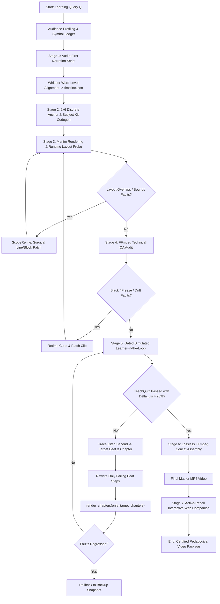

# Video Generation & Animation Pipeline: Code2Video + Lessonforge Hybrid

This document outlines the architecture, flow, and components of the **Educational Video Generation & Verification Subsystem**, integrating **Lessonforge's** audio-first deterministic transpiler with **Code2Video's** discrete visual anchor grid and **Learner-in-the-Loop** surgical beat repair.

The unified subsystem achieves:
1. **Audio-First Timeline Synchronization:** Spoken teacher narration synthesized and aligned via Whisper before visual elements are compiled, eliminating audio-visual drift.
2. **Deterministic Code-Drawn Subject Kits:** Replacing unconstrained LLM hallucinations with certified geometric and scientific drawing kits (`kits/`).
3. **Runtime Layout Probing:** Patched layout probes measuring element collisions and bounding boxes after every `play()` call, producing an SGA-compliant scene graph.
4. **Learner-in-the-Loop Beat Repair:** Psychometrically gated student models diagnosing misconceptions to cited seconds, re-synthesizing *only* failing beats, and re-rendering *only* affected chapters with atomic rollback guards.
5. **Technical Artifact QA:** Automated FFmpeg inspection of black frames (`blackdetect`), freeze frames (`freezedetect`), and sub-second AV onset drift.
6. **Active-Recall Interactive Playback:** Exporting standalone HTML5 companion players with automated checkpoint pauses and concept check quizzes.

---

## 1. Directory & File Structure

All core logic for the synchronized engine resides in:

* **[`src/lessonforge/longform/`](file:///Users/mdhassan/Developer/Code2Video/manim-main/lessonforge/src/lessonforge/longform/):** Audio-first timeline compiler (`audio.py`, `speech.py`), chapter runtime (`runtime.py`), and chapter build/assembly harness (`build.py`).
* **[`src/lessonforge/harness/`](file:///Users/mdhassan/Developer/Code2Video/manim-main/lessonforge/src/lessonforge/harness/):** Content harness, Socratic intake (`intake.py`), script writer (`writer.py`), quality gate (`qa.py`), and learner-in-the-loop repair (`learner_repair.py`).
* **[`src/lessonforge/kits/`](file:///Users/mdhassan/Developer/Code2Video/manim-main/lessonforge/src/lessonforge/kits/):** Deterministic STEM subject kits (Math, Physics, Chemistry) ensuring geometric and numerical correctness.
* **[`src/lessonforge/layout_probe.py`](file:///Users/mdhassan/Developer/Code2Video/manim-main/lessonforge/src/lessonforge/layout_probe.py):** Runtime layout probe recording bounding boxes, text overlaps, and canvas margins.
* **[`code2video/lessonforge_bridge.py`](file:///Users/mdhassan/Developer/Code2Video/code2video/lessonforge_bridge.py):** Bidirectional bridge connecting Lessonforge's scene graphs, MVQS calculations, and chapter repairs with Code2Video.
* **[`code2video/technical_qa.py`](file:///Users/mdhassan/Developer/Code2Video/code2video/technical_qa.py):** FFmpeg-based technical QA auditing black frames, static freeze frames, and AV onset synchronization.
* **[`code2video/verifier_security.py`](file:///Users/mdhassan/Developer/Code2Video/code2video/verifier_security.py):** Anti-reward hacking sanitizer and planted-fault judge recall evaluation suite.
* **[`code2video/channel_scoring.py`](file:///Users/mdhassan/Developer/Code2Video/code2video/channel_scoring.py):** Multimodal channel attribution (Voice vs Pictures vs Multimodal) calculating visual uplift ($\Delta_{\text{visual}}$).
* **[`code2video/public_benchmark.py`](file:///Users/mdhassan/Developer/Code2Video/code2video/public_benchmark.py):** Public benchmark evaluation runner across MMMC and VibeVideoBench educational tasks.

---

## 2. End-to-End Pipeline Flow

---

## 3. Detailed Component Breakdown

### A. The Planning & Audio-First Phase
* **Prompt Construction:** The planner analyzes topic complexity, audience grade level, and curriculum objectives.
* **Symbol Ledger Initialization:** Locks mathematical symbols (e.g. $F, m, a, \theta, \omega$) and color palettes across scenes to eradicate notation drift.
* **Whisper Forced Alignment:** Spoken narration is synthesized first, measured acoustically via Whisper, and saved to `timeline.json`. Every visual animation cue is anchored to an exact spoken word timestamp ($|\Delta T| < 40\text{ms}$).

### B. Discrete Anchor & Subject Kit Codegen
* **Discrete 6x6 Visual Anchor System:** Restricts element placement to coordinates $A1$ through $F6$, preventing collision with the left-hand lecture margin.
* **Subject Kits:** Deterministic geometric solvers draw triangles, coordinate axes, vectors, and chemical equations without relying on unconstrained LLM arithmetic.

### C. Runtime Layout Probing & SGA Scene Graph
* **Patched `layout_probe.py`:** Measures resting-frame bounding boxes after every `self.play()` call.
* **Cap Enforcement:** Enforces per-kind overlap limits (`_OVL_MAX_PER_KIND = 12`) while counting truncation as faults.
* **MVQS Metric:** Computes the SGA Multimodal Video Quality Score:
  $$\text{MVQS} = 0.5 \cdot \text{Spatial} + 0.2 \cdot \text{Layout} + 0.3 \cdot \text{Educational}$$

### D. Learner-in-the-Loop Beat Repair (Direction D2)
* **Timestamp Localization:** When a simulated student fails a Concept Check question, the cited second timestamp is traced through `timeline.json` to the exact instructional beat.
* **Root Cause Classification:** Classifies the error into:
  1. `never_taught`: Concept missing from narration and visual cards.
  2. `taught_but_unclear`: Concept spoken but visual representation lacked contrast or dwell time.
  3. `picture_contradicts_words`: Visual animation direction conflicted with narration.
* **Selective Chapter Re-Rendering:** Re-synthesizes *only* the failing beat's steps. Re-renders *only* the affected chapter via `render_chapters(only=target_chapters)`, saving $60\%–85\%$ of Manim compilation compute.
* **Atomic Rollback Guard:** Compares layout faults before and after repair; automatically reverts to snapshot if faults increase.

### E. Technical Quality & Anti-Reward Hacking
* **FFmpeg Inspection (D5):** Audits assembled MP4 files using `blackdetect` ($>0.5$s) and `freezedetect` ($>3.5$s) filters.
* **Anti-Reward Hacking (D8):** Sanitizes verifier inputs, stripping generator chain-of-thought, reasoning tokens, and invisible element hacks (`fill_opacity=0`, offscreen dumping).
* **Planted-Fault Recall Gate (D6):** Evaluates judges against synthetic bad fixtures, rejecting any judge with $<80\%$ recall.

### F. Master Video Assembly & Interactive Companion Player
* **Lossless Concatenation:** `ffmpeg -f concat -c copy` losslessly stitches rendered chapter MP4 segments into one master video without re-encoding artifacts.
* **Interactive Active-Recall Companion:** Generates responsive HTML5/JS companion interfaces (`interactive_lecture.html`, `index.html`) featuring automated chapter pause checkpoints, concept checks, and explorable mathematical parameter playgrounds.
