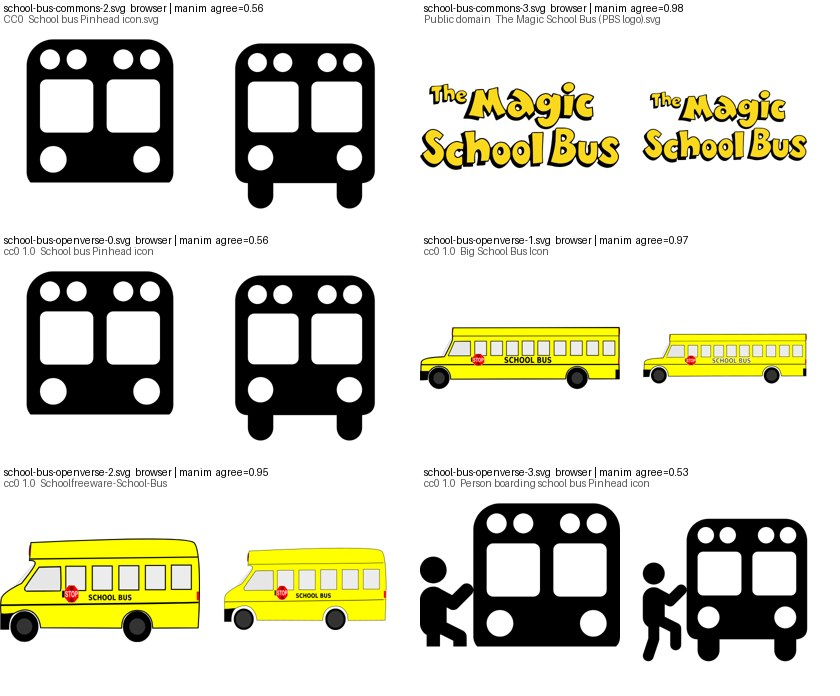
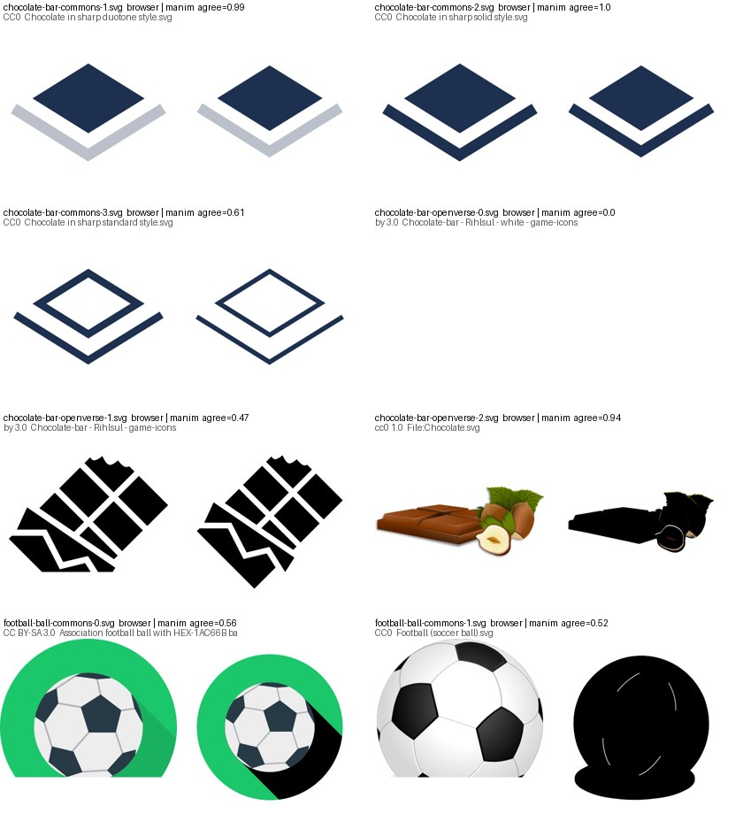
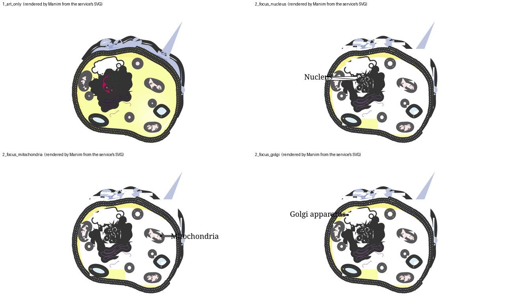
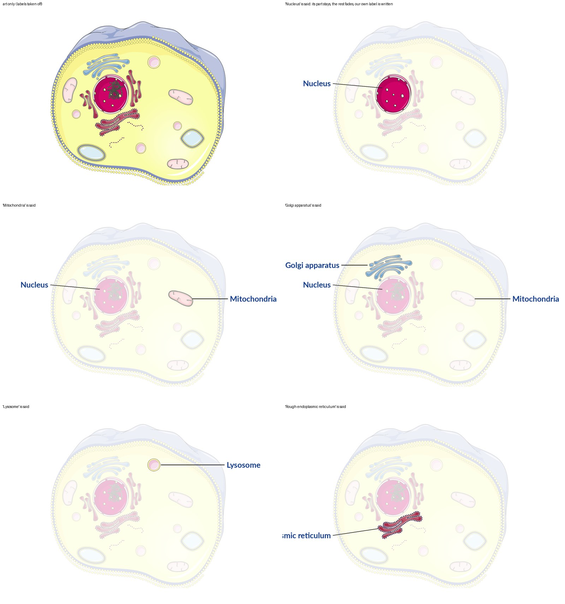
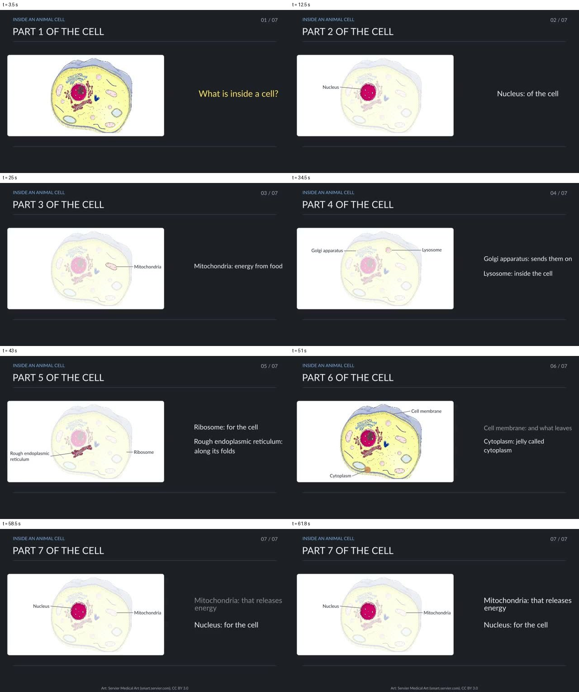

# 07 — Composition: layout, overlap, and pictures brought in as SVG

Written 2026-10-09. Three inputs: two documents the owner supplied that day (an analysis
of how the `agentic-edu-video` repository handles overlap, and a proposal for a
"constraint-aware video composition framework"), the six pilot videos made the same day
from the card pipeline, and a small probe of finding and importing SVG pictures. Nothing
in section 4 is built. Section 5 was run; its scripts are in
`lessonforge_workspace/pilot/` (`find_svg.py`, `import_test.py`).

Read with [`02_layout_and_composition.md`](02_layout_and_composition.md) (how other
generated-Manim systems handle layout, and the three approaches chosen there) and
`docs/engine/layout_framework.md` (what the probe measures). This file does not repeat
them.

## 1. The two documents, digested

Neither reports a measurement. The first describes what one repository does and where it
falls short; the second is a design. They are used here as a checklist of ideas, each
compared with what lessonforge already does.

**Document A — overlap handling in `agentic-edu-video`.**

- Overlap is four different problems and needs four different treatments: text on text
  (space), an action starting before the narration reaches it (time), captions, and a
  label that points at the wrong thing (meaning). One generic "fix the overlap" prompt
  solves none of them.
- What that repository does: labels are stacked in left and right gutters, sorted by the
  height of what they point at, with a fixed gap, and shifted up if the stack runs off
  the board. An arrow's label tries several positions along the arrow and takes the one
  with the least overlap area. One virtual pen is scheduled from word timestamps so no
  two actions run at once. The storyboard is validated by code before anything is
  rendered. A vision model inspects keyframes afterwards.
- Its weakness, by the analysis's own reading: **finding a collision is not the same as
  knowing how to repair it.** The vision check can report overlapping text, and the
  repair loop only knows how to redraw a picture or re-locate a label, so a layout
  finding can be reported and never acted on.
- Its recommendations: one registry of every bounding box; regions reserved before
  content is placed; text measured as it will really be shaped (Hindi included) before
  placement; a collision score; priorities, so the least important label gives way
  first; arrows routed around labels; checks on frames taken during an animation, not
  only at its end; a repair record that names the elements, the time, the measured
  overlap and the suggested move; a regression set of deliberately hard scenes; and
  repairs tried in code first, a model last.

**Document B — a constraint-aware composition framework.**

- Stop treating overlap as a defect to patch and treat the frame as a composition in
  four respects at once: where things are, when they appear, what they mean (which
  label belongs to which object), and whether a viewer can take it in.
- One shared structure for all stages: a scene graph whose elements carry an id, a role,
  a size and place, a time, relations to other elements ("labels", "points to",
  "depends on") and constraints marked required, preferred or optional. The renderer
  draws what this structure says and decides nothing itself.
- A hybrid solver: a model proposes, code enforces space and time, a vision model judges
  what geometry cannot. Placement by a small set of candidate positions scored as a
  whole, with hard constraints never traded away. Solved from the outside in: the scene,
  then regions, then elements, then connectors, then timing.
- Repairs in a fixed order, smallest first: move or resize one element; rearrange a
  region; stagger in time; simplify the content; split the scene.
- A failed check must never be recorded as a finished video because the repair budget
  ran out.
- Judge the framework, not one video: compare the old heuristics, the solver alone, and
  the solver with visual checks and repair, on a fixed set of hard scenes.

## 2. What lessonforge already does, and where the gap is

| Idea from the documents | In lessonforge today | Gap |
|---|---|---|
| A structured plan checked by code before rendering | Yes. The lesson contract and `writer.discipline` on the harness path; the storyboard IR with its gates on the engine path | None for text. A model-written `scene` is checked only for running, moving and staying in its box |
| Layout by code, not by the model | Engine: zones, split screen, graph layout in `transpiler.py`. Harness: `GuidedChapter` lays out two fixed columns once; five figure kinds are drawn by code from numbers | The sixth kind, `scene`, is free Manim code written by a model. The six pilots used 49 of them |
| Geometry measured after every animation | Yes: `layout_probe.py` after every `play` (text on text, clipped text, text over a shape) | It looks at text. A strip that slides off the frame was caught by a bounds check, not by the probe |
| A vision check of rendered frames | Yes: `harness/vision_review.py`, one frame per beat, findings by kind | Report only. Nothing is routed to a repair. This is exactly Document A's warning |
| Repair that keeps the better result | Engine: accept-if-better repair loop. Harness: a flagged chapter is re-laid compact and kept only if measurably better | No repair exists for a picture that does not match its words, or for anything inside a `scene` |
| Time handled separately from space | Yes, and it is the strong side: speech is made first, every cue waits for its spoken phrase, timing is labelled by how it was obtained | None from these documents |
| A failed check is not a success | No. Four of the six pilot lessons are "done" with `technical_checks_failed` | Open since the fifteen-lesson survey (REPORT §12) |
| A regression set of hard scenes | Engine: 24 harnesses. Harness path: none for figures or scenes | To build |
| One scene graph with ids and relations | Engine IR has ids, `connects`, `inside`. A harness `scene` has neither: no ids, no relations, no parts | **The main gap.** With no ids there is nothing a repair can name or move |

## 3. What the six pilot videos say the problem is

The frame review looked at 83 frames of the six lessons and made 45 findings:

| Finding | Count |
|---|---|
| The picture does not match what is being said | 25 |
| The picture is stale (left over from an earlier sentence) | 11 |
| Overlap | 5 |
| Clipped | 2 |
| Unreadable | 1 |
| Empty | 1 |

Eight in ten findings are about the picture and the words disagreeing. Overlap and
clipping together are seven of 45. A caution on the numbers: the reviewer is a model
looking at one frame per beat, its "does not match" has not been checked against a
person's judgement, and an earlier survey found its "clipped" verdicts were partly an
effect of when the frame was taken.

What was seen by eye in the same six lessons agrees with it and adds what a count cannot:

- Every lesson is still a slide: a heading, a small figure on the left, a list of text
  on the right.
- A picture drawn by code (the fraction bars) is clean and the same every time. A
  picture written by a model changes size, alignment and correctness from scene to
  scene: a division ladder too small to read in one scene and misaligned in the next;
  two "equal wholes" drawn at different places; force labels stacked on top of the box;
  two arcs sweeping the whole frame.
- One beat showed a bus while the voice talked about a box (fixed at its cause the same
  day: `critic.leaves_its_picture`).

So for lessonforge the documents are most useful for their larger idea (one structure
that knows what each thing on screen is and what it belongs to) and less for their
overlap techniques, most of which the probe and the fixed columns already cover.

## 4. What to adopt, in this order

Each step is useful without the next. None is started.

**A. Typed elements in place of free scenes.** The standard forms become figure kinds
drawn by code in `longform/figures.py`, each with named parts and label anchors: the
division ladder first, then a box with force arrows and a dot trail, then a tile array.
The model gives numbers and says which part each sentence is about; code decides every
position and size. This is the documents' scene graph at its smallest, and it gives
every part an id, which is what any later repair needs. `scene` stays for what no kind
can draw.

**B. The board takes the frame.** Regions are reserved before content is placed: a thin
title strip, a board of about seventy percent of the frame, one line for the key
sentence. Text steps stop being a column beside the picture and become labels attached
to parts of it, placed in gutters by the two rules from Document A (sort by the height
of the target and stack with a gap; try a few positions and keep the least crowded),
with the text measured first and a smallest size set for a phone screen.

**C. Pictures of objects brought in as SVG.** Section 5.

**D. Findings become actions.** A finding is a record: beat, time, the ids of the
elements, the kind, the measured overlap. Repairs are tried in code first (move the
label to the other gutter, scale the group to its region, split a step in two), the
chapter is rendered again and measured again, and a model is asked only when code has
nothing left to try. A lesson that still has a hard finding is shown as needing
attention, not as done.

**E. Seven hard scenes as tests**, from Document A's list: many labels on one diagram; a
long Hindi label; arrows that cross; a full equation board; a label that arrives while
its target is still being drawn; a small canvas; and a scene with a planted overlap that
the repair must find, fix and verify.

**Left out on purpose.** A general constraint solver with a weighted score over the
whole frame: both documents say to begin with rectangles and a greedy choice among a few
candidates, and nothing seen so far needs more. Routing connectors around obstacles.
Learned layout policies. The single-pen schedule (there is no pen here; the matching
rule is that one thing moves per sentence).

## 5. Pictures from SVG: what a probe found

The owner offered to supply SVG files, or to have them searched for, because
model-drawn objects are poor. On 2026-10-09 four objects were searched for ("school
bus", "chocolate bar", "beaker", "football ball") and every candidate was rendered twice:
by a browser, which is the reference, and by Manim's `SVGMobject`.

**Finding them.** Wikimedia Commons and Openverse both have a search that returns the
SVG file, its licence and its author, without a key (Commons refuses a request with no
contact in its user-agent; the project's `_WM_UA` works). Four queries gave 31
candidates, most CC0 or public domain.

**Search returns wrong things.** "beaker" returned a diagram of a pin-tumbler lock and a
map of the Beaker culture. "chocolate bar" returned an icon that is a blue diamond.
"school bus" returned the logo of a television programme. A search hit is a candidate,
never an answer: the same lesson as the icon search of 2026-08-14 (`icon_match_strength`).

**Flat pictures import well; shaded ones do not.**

The CC0 side views of a school bus come through Manim almost exactly. All 30 files that
were tried imported without an error.

A chocolate bar and a football drawn with gradients come through as black shapes, with
no error raised. The first comparison used here measured only the outline and scored the
black chocolate bar 0.94 out of 1: a check of an import must compare colour, not
silhouette.

**Tavily** (the owner's key, now `TAVILY_API_KEY` in `.env`, which `engine/sources.py`
already reads) is a general web search. For "school bus side view SVG public domain" it
found two CC0 sites worth knowing (publicdomainvectors.org, freesvg.org) next to shops
and sites whose pictures may not be reused, and it returns no licence. For "prime
factorisation division method diagram" it returned pictures of how the method is drawn
in textbooks and on teaching sites. Its uses here are therefore two: finding pages on a
short list of CC0 sites when Commons and Openverse have nothing, and fetching reference
pictures of a standard form for a vision model to describe (to learn the form, never to
show). CK-12 appeared in its results and forbids automated use, so results are filtered
by site.

**Design that follows.**

1. *The owner's own files come first.* A folder `<workspace>/library/pictures/` with one
   small record beside each file: what it shows, the view, the licence, where it came
   from. A picture found there is used without a search.
2. *Find*: Commons and Openverse, licence and author recorded; then the short list of
   CC0 sites through Tavily.
3. *Choose*: the title must match the object; a vision model looks at the browser
   rendering and answers "is this a plain picture of a school bus from the side, with no
   words and no logo?"; logos and trademarks are refused; CC0 and public domain are
   preferred because they need no credit on screen.
4. *Import*: Manim's rendering is compared with the browser's, in colour. If they agree
   the picture is used as vector shapes. If not, the browser's rendering is used as an
   image, which always looks right and cannot be animated part by part.
5. *Place*: the picture is one element with a box in the layout of step B, scaled to its
   place and never recoloured.

Two rules keep this from repeating 2026-08-15, when the owner had icon import removed
from the engine path ("the current one is very bad"): that board used fourteen copies of
one flat icon in place of a diagram. So a picture stands for an **object** (a bus, a
ball, a beaker) and never for structure (a ladder, strips, arrows are drawn by code);
and a lesson uses one picture per object, verified, or none.

Code that already exists for this on the engine path and should be reused, not written
again: the server-side resolution and attribution record of `resolve_wikimedia_image`
(`engine/assets.py`), `icon_match_strength`, and `viz_helpers._sanitize_svg_for_manim`
with `get_smart_asset`.

## 5b. Labelled diagrams from the owner's diagram service

The same day the owner pointed to their own diagram service ("this will give you a proper
animal cell") and asked how its SVG can be changed and animated. The service was called
three times and its answers taken apart. Scripts: `inspect_svg.py`, `animate_probe.py`,
`layers_probe.py` in `lessonforge_workspace/pilot/`; the two SVGs it returned are kept in
`lessonforge_workspace/library/diagrams/`.

**The service.** `POST /v1/diagrams` with a prompt, a class and a label language returns
an id; `GET /v1/diagrams/{id}` returns the status and, when done, the SVG and a PNG. No
key was needed. Results are kept six hours (the diagram first pointed to had already
gone), and the address is a quick tunnel, so it changes when the service restarts: a
lesson must keep its own copy, and the address belongs in the environment. A request
naming ten organelles failed its quality check after 35 s; "Labelled diagram of an animal
cell" passed in 21 s.

**Two kinds of answer.** The animal cell is library art (Servier Medical Art, CC BY 3.0,
with the credit line inside the SVG): 1.7 MB, about 5,500 shapes in 26 top-level groups,
and thirteen labels, each a text shape followed by its pointer line. A ray diagram of a
convex lens came back in 1.7 s as a 3 KB drawing of lines, circles and polygons with ten
text labels and no groups or ids. An importer has to handle both.

**Manim cannot draw the cell from its SVG.** It loads all 5,510 shapes in 7.6 s and finds
every group by id, but the picture is wrong: heavy black outlines, holes, a stray wedge
where a clip path is ignored. This SVG has no gradients, so it is a second way for an
import to go wrong without an error. SVG text is not supported at all ("Unsupported
element type"), so every label disappears.

**Layers drawn by a browser work.** The SVG is split by code into its top-level groups; a
headless browser draws the whole art and each group alone on a transparent ground, all
with the same view box, so the layers register exactly. 26 layers at 1600 pixels took
14 s. Saying "nucleus" then means: fade the art, keep the nucleus layer at full strength,
and write our own label at the place the diagram's label was.

**The parts name themselves.** Each label is followed by its pointer line, and the line's
far end is on or just short of the part. Walking a few pixels on from that end and taking
the smallest layer found there gave nine of thirteen labels a layer of their own: nucleus
(nucleolus shares it), Golgi apparatus, cell membrane, lysosome, mitochondria, vacuole,
smooth and rough endoplasmic reticulum. Four (microtubule, centrosome, ribosome,
cytoplasm) are drawn inside the cell-body group and cannot be lifted out; for those the
pointer's end is ringed instead.

**What this gives, and what it costs.** Our own labels mean Hindi or English at a size
readable on a phone, appearing when they are spoken. A layer can fade, pulse, grow or
move; it cannot be redrawn stroke by stroke or change shape. In the test one long label
("Rough endoplasmic reticulum") ran off the left edge: label placement is step B's work
and is needed here at once.

**Design that follows: a figure kind `diagram`.**

1. *Ask early.* The diagram is fetched in the research stage, when the teaching card names
   a labelled diagram as the standard form, and before the script is written.
2. *Take apart and keep.* Layers, a list of parts (name, layer, where its label and
   pointer sit) and the credit are saved with the lesson.
3. *Tell the writer.* The script writer is given the names it can point at, so a step's
   `focus` is one of them. This is the same contract the code-drawn figures have.
4. *Play.* At a step's spoken phrase the named part stays, the rest fades, the label is
   written. The credit is shown once, at the end.

**The division of work this fits into.** A script, whether written here or read from a
pasted document by `script_reader.py`, is already two tracks per beat: what is said, and
what must be seen with the words that trigger each change. The narration goes to the
voice and comes back as a timeline of spoken words. The visual task goes to whichever
maker fits, tried in this order: a code-drawn standard form; the diagram service for a
labelled picture of a real thing; an imported picture of an object; a model-written
scene last. Both tracks meet on the timeline. What is new is the order of the makers and
that each one returns the names of its parts.

## 5c. Built on 2026-10-09: the `diagram` figure

A third document from the owner the same day ("from online SVGs to animated educational
videos") proposes a pipeline: get an SVG by search or by generating it; make it ready to
animate by finding its meaningful parts and their anchors; plan motion as a checked list
of actions, never as free code; render every frame from the plan; inspect and repair the
smallest unit. The owner asked for it to be used on the current pictures. What was built
follows it where the probe of 5b agreed with it, and departs from it in three places.

**Taken from it.** An asset is kept with where it came from, its licence and a checksum
(`source.json`, `manifest.json`). An asset is usable only when its parts are named. The
writer does not write animation code: it names a part in a step's `focus`, and code
decides what that does. A part the diagram cannot give is refused, not guessed at. A
lesson that asks for a diagram nobody prepared loses the figure and keeps the beat.

**Done differently.** (1) The document renders in a browser with an animation library. Here
a browser only DRAWS, once, into layers, and Manim animates the layers, so there is still
one renderer and the speech-first timeline is untouched. (2) The document names parts with
a vision model. Here the diagram's own labels and pointer lines name them, by geometry,
with no model call; a vision model stays in reserve for art that has no labels. (3) Its
motion language has eleven actions. Here there is one: light a part and write its label.
Rotate, move and follow-a-path work on a layer and are the natural next ones; drawing a
path and morphing a shape do not work on a picture layer.

**What exists.**

- `harness/diagrams.py`: `fetch` (the owner's service, `DIAGRAM_API_URL`, answer kept in
  `<workspace>/library/diagrams/`), `safe`, `read`, `take_apart` (layers by a headless
  browser, parts named from pointers, `manifest.json`), `prepare`.
- `harness/card.py`: the card may carry `diagram_ask`; `add_diagram` fetches and takes it
  apart BEFORE the script is written, and `for_writer` gives the writer the exact part
  names it may point at.
- `harness/writer.py`: `use_diagram` makes every `{"kind": "diagram"}` the prepared one,
  keeps only focuses the diagram has (at most nine), and records the credit.
- `longform/figures.py`: `DiagramFigure`, a white card with the art, one cut-out per named
  part and our own labels; `focus_animations(name)`.
- `longform/runtime.py`: a wider box for a diagram, the focus hook, and the credit shown
  once in the lesson's last beat.

**Measured.** The animal cell: 91 layers drawn in 42 s; 12 of its 13 labels got a part of
their own (cytoplasm points into the body and gets a ring). A silent test lesson through
the real job runner rendered all seven chapters and passed every check.

**Three traps, each of which looked like success.**

- *A picture was made, so it worked.* Given a relative file address the browser drew its
  own "This site can't be reached" page, 92 times, opaque from corner to corner; every
  label was then reported as pointing at "the body". `take_apart` now refuses art that
  covers the whole canvas: a drawing on a transparent ground never does.
- *Cut by position.* A limit of sixty parts kept the first sixty in the file, which were
  stray dots, and dropped every organelle. The limit keeps the parts made of the most
  shapes.
- *One group to go into.* The service wraps the drawing and adds a credit group beside it,
  so "go down while there is a single group" stopped at the wrapper. The drawing is the
  group with the most wordless children.

**Limits today.** The card with the diagram is still a box in the slide layout (the other
session is changing that layout). Each chapter starts with the whole diagram and no
labels, since a chapter is its own render. One service is the only source. Only one kind
of answer from it (library art with pointer lines) is named automatically; its simple
drawings (the ray diagram) have labels but no pointers, so their parts are not named yet.

## 6. Decisions for the owner

- Whether step B (the board takes the frame) comes before or after step A. B changes
  how every lesson looks and is the larger change to the render path; A is smaller and
  fixes the least consistent pictures.
- ~~Whether pictures that need credit are allowed.~~ **Answered 2026-10-09** ("add cred
  once also"): pictures that need a credit (CC BY, CC BY-SA) may be used, and the credit
  is shown once per video. Read as: one credits card at the end listing every picture
  with its author and licence, and the same list kept with the lesson. Share-alike
  pictures still need a person's look before a video is sold or relicensed.
- Whether an image fallback is acceptable for a shaded picture, given that its parts
  cannot then move separately.
