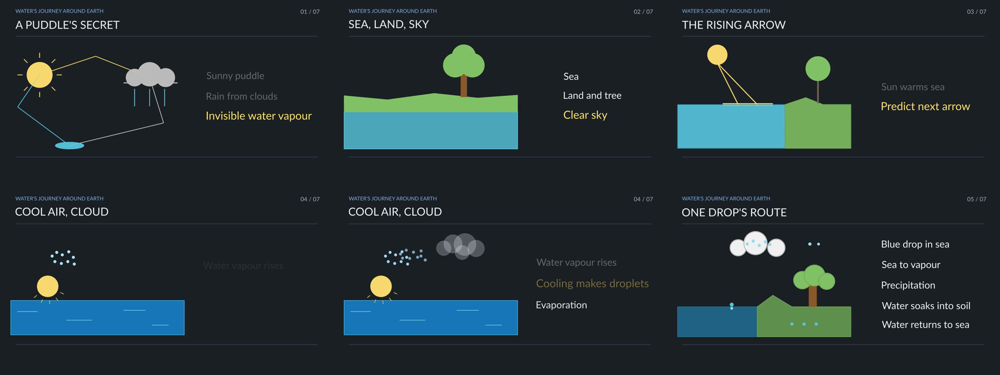
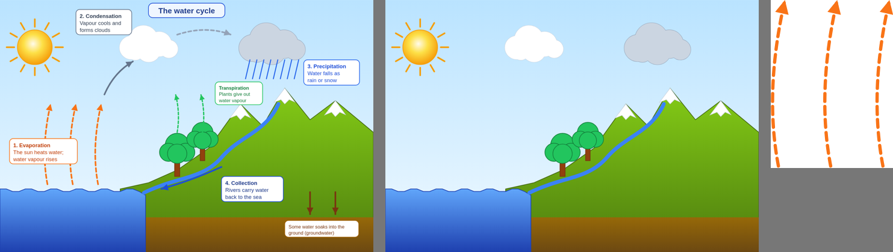
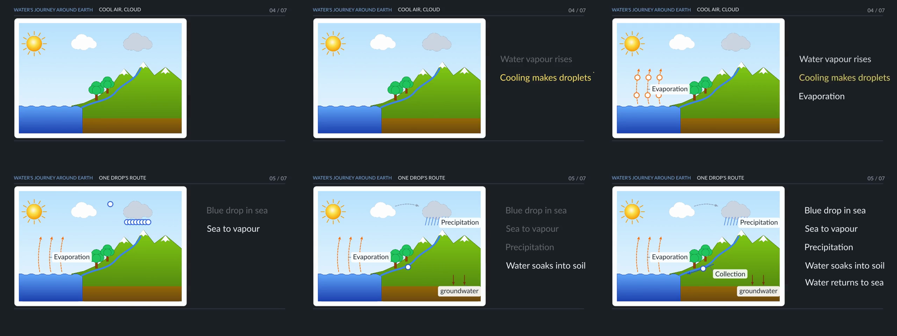
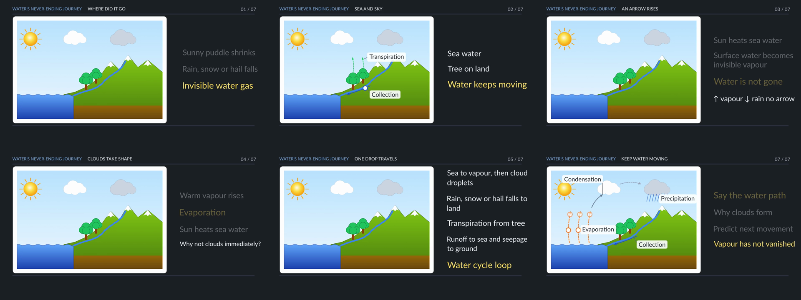
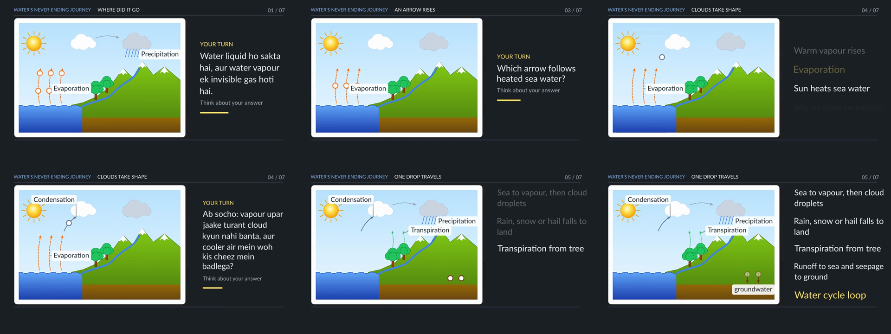
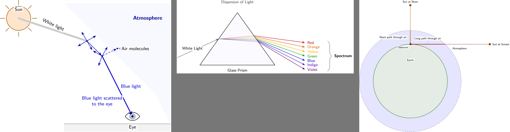
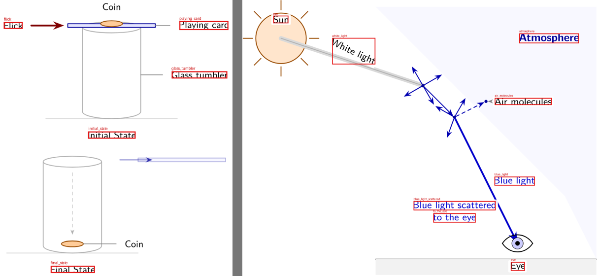
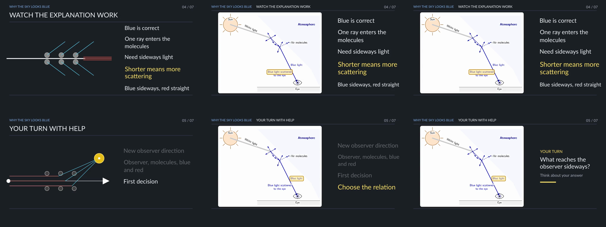

# 08 — How a lesson sounds, how each source teaches, and a second kind of diagram

2026-10-09. Three things the owner asked for in one message and two follow-ups:

1. two system prompts ("Lesson Plan Reverse Engineering" and "Markdown Lesson Cleanup"):
   *"useful in our system, get the best things from this"*;
2. the current videos *"feel a bit off, not natural"*;
3. the diagram service's new call (one waiting request, a key): *"use this for getting svg"*.

Everything below is built and unit-tested (206 tests). What a real model made of it is
stated where it was tried. **No video has been made with these changes**: the one run
that was started was stopped at the review stage, to leave the last of the spending cap
to a lesson the owner had started from the app. Nobody has heard any audio.

---

## 1. Why the lessons did not sound natural

Read across five lessons (`timeline.json` and the narration), the same things were in
every one, so they are the system's doing and not one lesson's.

| What a listener notices | Cell 13:32 | Squares (hi) | Inertia (hi) | Fractions (en) | Inertia (en) |
|---|---|---|---|---|---|
| Sentences that are an order (dekhiye, sochiye, kijiye) | 14 of 44 | 15 of 45 | 17 of 57 | 9 of 55 | 8 of 58 |
| Most common first word, and how often | Ab, 7 | Ab, 7 | Ab, 8 | The, 4 | The, 6 |
| Sentences about the screen ("picture mein", "side by side") | 7 | 0 | 0 | 3 | 1 |
| Stops with thinking time, and their silence | 7, 32 s | 6, 25 s | 7, 34 s | 7, 32 s | 7, 32 s |
| Chapters (a title card each) in a 4 to 5 minute lesson | 7 | 7 | 7 | 7 | 7 |
| Speaking rate while speaking (words a minute) | 141 | 199 | 189 | 197 | 186 |

Read as a script, the first diagram lesson also:

- asked its opening question four times in other words (0:00, 0:37, 1:48, 4:12);
- was English with Hindi glue: *"Sabse chhote picture mein one thin outer edge aur one
  soft inside space hai"*, *"controls what enters and leaves ko kis part se connect
  karenge?"*;
- opened with a row of definitions (*"Cell ek tiny living building block hai. Bahut se
  cells … Food aur oxygen materials hain … Waste woh cheez hai …"*);
- had five of seven titles built alike (*"WHY … NEEDS …"*), because the title note gave
  one example and the model copied its form.

And one thing seen only in frames: the second diagram lesson (13:57) drew the cell
**twice**. For the first two minutes a model-written scene of polygons stood for the
cell ("a thin edge, a round centre", before the parts had names); the real drawing came
at 2:30. Nine of its thirteen beats were scenes.

Pace is no longer a cause: the earlier pilots spoke at 186 to 199 words a minute, the
current voice setting gives 141.

### What was changed

| Fault | Where it is fixed | Kind |
|---|---|---|
| All of the above, as rules with wrong/right pairs from the real lesson | `skills/teaching-script/voice.md` (the writer reads it; not part of what a card is made from, so no card is rebuilt) | prompt |
| The same faults, found in named beats | `harness/voice.py`: `findings`, `report`, `line` | code |
| Someone acts on them | `voice.polish`: ONE rewrite call for the beats with faults. Each returned beat is tried on a copy through `critic.apply_edits` and kept only if that beat then has fewer faults, still ends with (or without) its question, and gains no language or repetition finding | code + one model call |
| The opening question asked again | `writer.card_notes`: chapters after the first are told it was asked | prompt |
| Titles all alike | `card_notes`: three unlike examples, "not built like the title before it" | prompt |
| Two stops in one chapter | `card_notes`: "one stop at most" (**not yet tried on a model**) | prompt |
| The thing drawn twice | `card.for_writer`: the prepared diagram is the lesson's one picture of the thing from the first beat that shows it; a scene only for a different object | prompt |
| What is still open after all that | `critic.review` lists `voice.findings` as minor findings | code |

`voice.polish` runs at the end of `writer.write_lesson`, before the reviewer, so a
changed sentence is reviewed like any other. It rides with the teaching card
(`LESSONFORGE_VOICE_POLISH=1` or `0` decides for every lesson): one more writer-model
call for a lesson that has something to rewrite.

Every rule in `voice.py` is loose on purpose and each exemption came from a false alarm
on a real lesson: the recap may give orders and ask the lesson's question again; the
beat that sets the try-it task may give orders and say "draw"; "chaliye … dekhte hain"
is not an order; the same question about another number is practice; a word the module
does not know is never called English, because Hindi's vocabulary is open (the first
cut flagged *"cells milkar animal body banate hain"*).

### What one real script showed (same topic, same card, same diagram)

| | 13:32 | 13:57 | 14:22, new rules |
|---|---|---|---|
| Orders | 14 of 44 | 18 of 51 | 11 of 50 |
| Top first word | Ab, 7 | Ab, 7 | Yeh, 4 |
| Sentences about the screen | 7 | 1 | 0 |
| Faults found, after the rewrite pass | 11 | 8 | 0 (3 found, 3 rewritten, 0 refused) |
| Beats on the real diagram | 13 of 13 | 4 of 13 | 14 of 14 |
| Titles | "WHY TINY CELLS NEED SUPPLIES" … | "WHY A CELL NEEDS AN EDGE" … | "A cell has needs", "One cheek cell, four jobs", "A boundary that works" |
| Stops | 7, 32 s | 7, 30 s | 8, 35 s |

It reads better: *"Gaal ke andar se li gayi yeh ek cheek cell … bahar ek patli si
boundary aur andar naram space. Lekin is chhoti si cell ko zinda rehne ke liye …"*,
*"Yeh theek hui boundary ab cell membrane kehlaati hai."* What is still wrong in it:

- **the stops did not go down** (8 in 14 beats, three in a row at beats 4, 5 and 7).
  "About once a minute" with seven chapters is the design, and it is the largest
  remaining reason a lesson feels like a quiz. Fewer stops is the owner's decision;
- one sentence is still the card's English, translated (*"boundary ko contents rokne
  bhi hain, lekin selected materials ko cross bhi karne hain"*): the card's lines are
  handed to the writer in English and get carried over word for word;
- it speaks of arrows that are not on the screen (*"exchange ka arrow cell membrane tak
  jaata hai"*): the try-it task has arrows, the diagram does not. `voice.md` now says
  so; not yet tried;
- *"char zaroori jobs"*: the language check will ask for "four". `voice.md` now says
  ek and do stay Hindi and a count from three on is English.

The script is kept (`lessonforge_workspace/pilot/drafts/cell_voice_20261009.json`) and
can be rendered with `draft_file`, with no writer cost.

---

## 2. What was taken from the two prompts

### "Lesson Plan Reverse Engineering"

The prompt turns a finished lesson into the plan a designer would have written before
it: objectives with Bloom's levels, an essential question, the flow as phases with an
instructional role (Gagné's events, Merrill's principles and the 5E phases folded into
six), the type and purpose of the examples, the scaffolding, the misconceptions, and
what the lesson leaves out. Its rule is "reverse-engineer, don't summarise".

Our gap it fills: the card maker saw each source as **passages chosen by search**. The
order of a lecture, what each part of it is for and how the teacher talks were not in
what it was given, so the card's route was invented from fragments.

| Idea | Where it is now |
|---|---|
| A plan per source, in one vocabulary | `library.blueprints(pack, folder)`: one small call per textbook chapter, lecture and lesson plan, cached beside the pack (`blueprints.json`). `library.BLUEPRINT_SYSTEM` is the owner's prompt cut to JSON |
| Six instructional roles, six levels | `library.ROLES`, `library.BLOOM`: closed lists. A phase or objective outside them is dropped by code |
| "Preserve the sequence" | `shape_blueprint` puts the phases back in the order of the passages they cite |
| "Don't copy" (also our licence rule) | a line carrying nine words in a row from the source is dropped |
| The plans reach the card | `card.make_card(..., plans=)` puts them above the passages; `card.md` says how to read them (lay the flows side by side; a role none skips belongs in the route; a role all skip is a gap) |
| Measurable objectives with a level | the card's `objectives`: two to four, each with a level and `checked_by` (opening, q1…q3, try_it). `card.check` refuses an objective with no place where the learner does it, and a card whose objectives are all recall |
| The objectives are done, not told | `card.for_writer` lists them; the recap is told to have the learner do each |
| How the lecturer talks (our addition) | `manner` in a lecture's plan, carried to the card as `teacher_talk` and shown to the writer as a manner to take up |
| "Enduring understanding, not a restated fact"; "be specific" | one line each in `card.md`'s objectives rule and in the reader's prompt |

Tried on the cell topic's three sources (0.004 USD, 3 calls):

```
S1 textbook  demonstration → demonstration → application → demonstration → demonstration → integration → integration
S2 lecture   motivation → demonstration → integration → assessment          (Hindi, a journey into the body)
S3 lecture   motivation → demonstration ×5 → assessment                     (organelles as one system, not a list)
roles across the three: motivation 2, activation 0, demonstration 3, application 1, integration 2, assessment 2
```

It read the Hindi lecture's manner as "opens with an imaginative scenario, addresses the
viewer directly, ends with a direct recall question", and the textbook's own analogy
("bricks and walls") and its anticipated mistake ("cells are simple liquid-filled bags").
**A card has not yet been made with the plans**: that is one card call (about 0.15 USD)
and it waits for the cap. Changing `card.md` changed `skill.card_version()`, so every
cached card is rebuilt the next time its topic is used: a billing change, once per topic.

Not taken: the Markdown template itself (our card is the form), and a seventh stage for
"integration". Two of our three frameworks have no stage whose job is transfer; that is
a finding, not yet a change.

### "Markdown Lesson Cleanup"

Its golden rule is ours for a pasted script (the words are the author's): fix how the
content is formatted, never the content, and *when in doubt leave it: a false fix is
worse than no fix*. So it became a table in code, not a model.

`library.clean(text)` runs on every source as a pack is built: text that was UTF-8
read as Windows-1252 (`°`, `×`, `≥`, `π`; a sequence is replaced only when it
decodes back to exactly one character), HTML entities and leaked tags, printer's
marks, and bullets read as a letter. What it removes was counted on the library first:
in 56 NCERT chapters, **964** printer's lines ("Chapter 2.indd 15 …") and **385** lines
holding only "z" (a symbol font's bullet). No mojibake and no entities were found in
NCERT; those lines are for web pages a requester hands in.

Not taken: restoring LaTeX from plain text, fixing code blocks and tables (none of our
sources has them), and running any of this on a pasted script (`scripted.py` is the
other session's; `library.clean` is there for it).

---

## 3. The diagram service's new call, and a second kind of drawing

`harness/diagrams.py: fetch` now sends one request that waits
(`POST /v1/diagrams?wait=90`, `X-API-Key` from `DIAGRAM_API_KEY` in `.env`), follows an
`id` when the drawing takes longer, keeps the service's PNG beside the SVG, and reads
`quality`. A drawing whose own checks failed is kept as `refused.svg` and not used
(`DIAGRAM_MIN_QUALITY`, default `review_needed`). `labels=False` asks for the drawing
alone. A diagram already in the library is found under the name it was saved with.

The water cycle came back in two seconds and is a different kind of drawing from the
animal cell:

| | Office export (the cell) | Flat poster (the water cycle) |
|---|---|---|
| Structure | groups of shapes | shapes straight under `<svg>` |
| A label | text with a pointer line | a rounded box of words, no pointer |
| What the label is about | found by following the pointer to a layer | the arrows drawn just before the box in the file, and strokes in the box's own colour (the rain under "Precipitation") |
| Layers drawn by the browser | one per shape (91, 43 s) | one per box (6, 4 s) |

For a poster, `diagrams.callouts` makes each box one label (its heading only; the rest
is for the voice, and 17 px words in a 1180 px drawing cannot be read in a video), takes
the boxes out of the art, and makes the box's arrows the part that lights up. The
manifest has the same shape, so `figures.DiagramFigure` shows it with no change: a local
render (no model, no cost) lit the rain when "precipitation" was focused and wrote
"Evaporation", "Condensation", "Precipitation" in the lesson's font
(`08_assets/water_cycle_probe.png`).

Known weak spots of the poster kind: a label stands where its box stood, which can be
over the drawing (the pointer for "Condensation" runs through the cloud); a box with no
heading is named by a word it gives in brackets or by its first three words.

**Waiting to go in** (`figures.py` is a render-path file and a lesson of the owner's was
rendering): the other session rendered a copy of a lesson with the water cycle and saw
the drawing at 43% of the frame's width beside an empty white strip (the labels' room
was counted in the card) and a pale wash for most of the lesson (the art dimmed to 0.28
while a part is lit). The change is written and checked on a scratch copy: a poster's
labels stay inside the art, each on a small plate, so the card is exactly the art, and
the dimming is 0.5 for both kinds (`08_assets/water_cycle_plates.png`). The patch and
its test are in `lessonforge_workspace/pilot/patches/diagram_figure_poster/` with the
three commands that apply them.

**A bug found on the way.** A headless window's page is 87 px shorter than
`--window-size`. Every layer was therefore missing its bottom 87 px: the animal cell's
art ended at row 785 of 872, cutting 27 px off the drawing, and nobody saw it because a
diagram has margins. The water cycle's ground was cut in half. The window is now asked
for 160 px taller and the picture cut back; a page still shorter than the drawing gives
no picture. Checked on a copy of the cell (art now to row 812, the same twelve parts).
Manifest version 3: saved manifests rebuild themselves at their next use.

---

## 4. Decisions waiting for the owner

1. **The spending cap.** OpenRouter counted 28.86 of 30 USD at 14:30. Nothing more of
   this can be tried on a model until it is raised (`lessonforge budget +10`).
2. **How often a lesson stops to ask.** Seven or eight stops in five minutes is the
   current design ("about once a minute", and every chapter that predicts, practises or
   recalls must stop). Three or four (the opening question, the why, one practice, the
   recap) would sound like a lesson with questions rather than a quiz with explanations.
3. **Seven chapters in every lesson, whatever its length**: a title card every 32 to 43
   seconds. Short lessons could show a title only where the lesson turns (three or four).
4. **Sarvam is out of credit** (the other session's finding, 13:58): lessons are being
   narrated by the fallback voice until its key is topped up.

---

## 5. The picture a topic is known by (added 15:10, the same day)

The owner, after the sections above: *"don't generate lessons from your side; continuously
use this API to make SVGs for the required topic to use in the video"*, and then: *"you
need to ask [for a] visual thing, like in NLM inertia what it knows [as a] visual, so we
need a visual, not just some arbitrary thing."*

### What the service draws

Eight requests, each a topic or a short description (`08_assets/service_drawings_eight_topics.jpg`):

| Asked for | Came back | Its words | What a lesson can do with it |
|---|---|---|---|
| Human heart with its four chambers | anatomical art, student ready | text with pointer lines | 10 of 12 parts light up when named |
| Animal cell | anatomical art, student ready | text with pointer lines | 12 of 13 parts |
| Water cycle; photosynthesis in a leaf | flat posters, student ready | rounded boxes of words | each box's arrows light up (6 of 6; 5 of 8) |
| Ray diagram of a convex lens | flat figure, student ready | words beside the things | Object, Image, F and 2F light up (6 of 10) |
| One half plus one third; prime factors of 36 by division; a 4 by 4 square of tiles | the standard classroom form of each (area model, division ladder, tile grid) | **set as outlines** (typeset maths) | nothing can be named: shown whole |
| Parts of a flower; "Newton's first law of motion: inertia" | failed the service's own checks | | kept aside as `refused.svg`, not used |

The inertia request failed because a topic is not a picture. Asked instead for the
demonstration the topic is known by, with `min_quality` set, the service drew it in
half a minute, student ready: a coin on a card over a glass tumbler, the flick, and the
coin fallen straight down (`08_assets/topic_pictures.jpg`).

### What was built

| Step | Where |
|---|---|
| How a request is worded: a picture, never a topic; the real thing labelled, the classic demonstration as one still picture with before and after side by side, or the standard diagram of the method | `diagrams.VISUAL_RULE` (one text for this step, the card's `diagram_ask` in `card.md`, and offered to the script path) |
| A small model says what a teacher draws for the topic: up to three requests, the textbook's own activity first. Code drops a request that is the topic said again | `diagrams.visuals_for` (`note="visual"`, about 0.001 USD) |
| The service draws each; the first in the model's order that can be shown is the lesson's picture; the choice is kept per topic and class | `diagrams.for_brief`, `library/diagrams/topics.json` |
| Two ways to show a drawing: by its parts when three or more can be named, otherwise whole | `diagrams.showable` → the `diagram` figure or the other session's `picture` figure |
| Words beside a thing (the ray diagram) name the marks of their own colour | `diagrams.free_marks` |
| The service is told the least it may return, so it redraws by itself until its checks pass | `min_quality` in `diagrams.fetch` |
| A lesson with no card is written on its topic's picture; a card lesson on the card's `diagram_ask`, shown either way | `writer.write_lesson`, `card.add_diagram`, `card.block_for` |

Run end to end on four topics people asked lessons about today (one small-model call
each; the drawings were taken to be free at the time, which was wrong: see "What the drawings cost" below):

| Topic | The picture chosen | Shown |
|---|---|---|
| Newton's first law (inertia), class 9 | a coin on a playing card over a glass tumbler, and the same tumbler after the flick | whole |
| Square numbers through prime factorisation, class 8 | the factor tree of 36 with its primes grouped into two identical pairs and their product 6 | whole |
| Adding fractions with different denominators, class 6 | two paper strips of the same length, one half shaded and one third shaded | whole |
| Parts of an animal cell, class 8 | a labelled cross-section of an animal cell | 13 parts to point at |

**Not yet seen in a video**: the owner asked for no lessons from this side, and the
running server has none of this until its next restart.

### Limits to know

- **Typeset drawings cannot be pointed into.** A demonstration, a ladder or a strip model
  comes with its words as outlines, so the lesson can only show it whole and say where to
  look. Its print is small on a phone; the step text beside it must carry every word.
- **The service draws afresh each time.** The same request gave two different division
  ladders. The library's copy is the one a lesson uses, and it is kept.
- **The small model does not always pick the best-known picture.** For inertia it first
  proposed a pile of carrom coins (which the service could not draw) and then the coin
  and card. A card lesson has the stronger model and the textbook's passages for this.
- **A whole picture does not move.** Revealing a typeset drawing in stages (the ladder
  row by row as the voice divides) needs either names from the service or a reading of
  the picture; neither exists yet.

### What the drawings cost (found 15:40, by the other session)

I sent about twenty requests to the service that afternoon as if they cost nothing. I
had not checked. OpenRouter's count for the app's own key rose while the app's ledger
stood still:

| Window | OpenRouter's count | The app's ledger | My requests to the service |
|---|---|---|---|
| 14:54 to 15:09 | +1.39 | +0.00 | 12 |
| 15:09 to 15:20 | +3.62 | +1.09 | 8, all with `min_quality` (the service redraws until its checks pass) |
| 15:20 to 15:33 | +0.67 | +1.08 | 0 (the count lags the ledger) |
| 15:33 to 15:41 | +1.18 | +0.00 | 0 |

About 4.7 USD left the key outside the ledger in those 47 minutes, and the cap (35) was
passed at 36.87 with the ledger at 29.21. The first window is the clean one: 1.39 USD,
no other call, twelve requests, two of which came back in a second or two and were
probably drawn from a template. So a drawing that a model draws costs roughly 0.12 to
0.15 USD, and more when it is redrawn to pass its checks. **This is an inference from
the timing; the owner has not yet confirmed that the service uses this key.** The last
window had no request of mine and is either the count catching up or someone else on
the key.

**Settled at 16:18:** the count stood at 37.61 from 15:47 on (37.68 half an hour later), with both
sessions idle. So nothing else was using the key: the later rises were the 15:09 to 15:25
requests being billed late. About 4.7 USD for about twenty requests, two of them near-instant,
is roughly 0.25 USD for a drawing a model draws with `min_quality` on, which is what
`DIAGRAM_COST_ESTIMATE` defaults to. OpenRouter's count for a key can run half an hour behind.

What changed because of it (`diagrams.py`): every request first asks the budget guard
(`spend.check` with `DIAGRAM_COST_ESTIMATE`, default 0.25 USD) and is refused when the
cap has no room; every answered request is written to the ledger as kind `diagram`,
marked estimated, so `lessonforge spend` shows drawings on a line of their own;
`for_brief` asks one drawing at a time in the teacher's order and stops at the first
that can be shown, two at most (it asked three at once and used one). A new topic then
costs one small-model call and usually one drawing, once: the choice and the drawing are
kept.

---

## 6. A demo made with no model at all, and the owner's own speech service (16:10)

The owner asked for "a small demo video to see this working of delegation of rich
visuals" and gave a text-to-speech service of their own to try for its audio (Hindi,
English and mixed text, 24 kHz, four voices: kavya, agastya, maitri, vinaya; a local
server behind a quick tunnel, so nothing on OpenRouter).

- **The voice**: `longform/speech.IndicBackend`, spec `indic:<voice>[@temperature]`,
  address and key in `.env` (`INDIC_TTS_URL`, `INDIC_TTS_KEY`). Strict like the Sarvam
  backend: a failed clip raises, so a lesson never changes narrator mid-way. A seed is
  always sent, so a block asked for again is the same clip. It is recorded in the
  ledger at zero dollars. It is NOT in `service.voice_candidates`: whether it becomes a
  default voice is for the owner to say after hearing it.
- **It wants Hindi in Devanagari with English words in Latin letters** inside the
  sentence. Our Hinglish lessons are written in Latin letters throughout; a lesson for
  this voice is language `hi-IN`. Whether it reads Latin-letter Hinglish acceptably has
  not been listened to.
- **The lesson**: `lessonforge_workspace/pilot/make_demo_lesson.py` writes six beats by
  hand (words, steps, focuses, pictures) and `run_demo.sh` renders them with every paid
  provider's key blanked for that process: no writer, no reviewer, no scenes, no
  alignment, no frame review, no drawing request. `writer.load_draft` accepts a lesson
  whose `generated_by` starts with "written by hand" for this.
- **The three pictures**, all already in the library: the water cycle (a poster: each
  process's arrows light and its name is written on a plate), the heart (anatomical art
  in one piece: a ring at each pointer's end; before this demo every label lit the whole
  heart, because all ten pointed into the one layer), and the coin on a card over a glass
  (typeset, shown whole).

### What the demo showed (lesson `20261009-161510-999aa2`, 1:50, 720p)

Frames looked at; the audio has not been listened to by me.

- **Water cycle** (`08_assets/demo_water_cycle.jpg`): at "evaporation" the three rising
  arrows light and the name is written on a plate; then the arrow into the cloud, the
  rain, the river arrow. The rest of the drawing dims to half while a part is lit.
- **Heart** (`08_assets/demo_heart.jpg`): a ring and a name at the right atrium, right
  ventricle, pulmonary artery, left atrium, left ventricle and aorta, each on its step.
- **Coin and card** (`08_assets/demo_coin.jpg`): the picture whole, before on top and
  after below, with the steps beside it.
- **Voice**: six blocks from the owner's service, 290 words in 97.3 s of speech: 179
  words a minute, brisker than the 140 the lesson lengths are budgeted on; its API has no
  pace setting. Each block took 4 to 8 s to come back.
- **Timing** is estimated in this demo, not measured: aligning words needs the paid
  recogniser, which was switched off. Text cues are placed by word position inside each
  sentence.

Two faults were found in the first render's frames and fixed before the second:

1. **Every name on the heart was one place off.** The service's anatomy drawings write
   pointer line, dot, words; the reader paired words with the line after them, as an
   office export writes it. "Right ventricle" pointed at the inferior vena cava. A label
   now takes the line that starts level with its words, on either side
   (`diagrams.read`, pinned by a test). All checks had passed: nothing but looking at the
   picture could have caught it.
2. **The before-and-after picture was a strip.** At 1280 by 389 it filled the picture
   box's width at 107 px of height. `diagrams.stacked` re-lays a wide picture that has
   an empty gutter between two panels, second under first (`whole_stacked.png`), and
   `showable` prefers it.

Still weak: the picture box is the left half of the frame whatever the picture, so a
tall or a wide drawing leaves much of the frame empty; a whole picture does not react to
the voice at all; the app shows its "no language model, placeholder outline" banner on a
hand-written lesson.

---

## 7. Using a drawing's pieces, not only lighting them (16:30 to 16:50)

The owner, after the first demo: *"current svg is not being intelligently used by
splitting and using at the center etc, this is a raw way of using; think of improvements
and try to use APIs for most so we have better scope of using better code and
scripts."* They were right. The demo cut each drawing into parts and then only dimmed
the picture and lit one part, in a card a quarter of the frame's area.

### What each kind of drawing can do, and now does

| Drawing | What the SVG gives us | What the lesson does with it now | Before |
|---|---|---|---|
| A poster with boxes of words (water cycle, photosynthesis) | each process's arrows as separate elements, with their path geometry and colour | **Built up**: the scene stands alone; a process's arrows are drawn in when it is named and stay; its name is written on a plate; beads run along the arrows (vapour up, rain down, the river to the sea) while it is the subject. Nothing is dimmed | everything on screen from the start, dimmed to half, one part lit |
| An anatomy drawing with pointer lines (heart, cell) | a vector drawing and the place each name points at | **Zoomed**: the card cross-fades to a close-up of the named place, drawn again by the browser with the SVG's view box there (sharp at any size), with a ring and the name; a small overview in the corner shows where it is | a ring on the whole drawing, each part a few pixels across |
| A typeset before-and-after picture (coin and card) | an empty gutter between two panels | **Panels**: "before" is on screen while the lesson asks what will happen; "after" comes in on the step that says it | both panels visible from the start: the answer was on screen during the question |
| Any drawing whose maker names its parts (`data-part="…"`) | the names themselves | believed before any guessing | not read |

Lesson `20261009-163940-722331` is the same hand-written demo and the same narration,
re-rendered with these (no paid call): `08_assets/smart_water_cycle.jpg`,
`smart_heart.jpg`, `smart_coin.jpg`, and `smart_closeups.jpg` (enlarged, from local
probes). Checks all passed. The other session's new stage layout (a one-line heading, a
picture box 8.85 by 5.7 with the steps beside it) was not yet in when this was
rendered, so the card is still the old size.

How it is built: `harness/diagrams.py` writes what is needed into the manifest (version
9): `base` (the scene with no process in it), per label `flows` (arrow paths in pixels,
from `_polyline`: lines and absolute M/L/Q/C paths) and `colour`, `detail` (a close-up
file and its region; all close-ups share one window shape, at least 1.5 to 1), and
`panels` with `panel_boxes`. `longform/figures.py`: `DiagramFigure.mode` is `built`,
`zoomed`, or the old `poster`/`pointers` for a manifest without those pieces;
`PictureFigure` takes `panels`. `focus_animations(name)` is still the only thing the
renderer calls.

Three things went wrong on the way and are pinned by tests:

- **Beads ran where the arrows had been.** Their tracks were computed when the figure
  was built; the renderer scales and moves a figure afterwards to fit its box. A track
  is now kept as shares of the art's own rectangle and turned into screen points on
  every tick.
- **The zoom marker covered what it marked.** `set_opacity(1)` on a `Circle` fills it.
  A ring's stroke is animated, its fill never.
- **A name was written under its own ring** when there was no room beside it. The name
  goes on the side that has room, else under or over.

### What would make the splitting exact: a request to the drawing service

Everything above is inferred: which arrows belong to which box (file order and colour),
where a pointer ends, where a picture's panels divide. It works on the drawings seen so
far and it will guess wrong on some. The service knows all of this when it draws. If
its answer carried it, our side would be a few lines of reading instead of several
hundred of guessing, which is what "use APIs for most" buys:

1. **Name the parts in the SVG.** One `<g data-part="Evaporation" data-order="1">` for
   each thing a teacher would point at, holding everything that belongs to it (its
   arrows, its shape). `diagrams.read` already believes `data-part`.
2. **Keep words as text.** `<text>` elements, never outlines, also in typeset drawings
   (the division ladder, the fraction strips, the coin and card). Today nothing in those
   can be named, so they can only be shown whole.
3. **Say the order.** `data-order` on the parts (or a `steps` list in the JSON reply):
   the order in which a teacher would build the picture up.
4. **Mark the panels.** `<g data-panel="1">`, `<g data-panel="2">` for before and after,
   instead of our looking for an empty gutter.
5. **Return the description it drew from.** A `parts` list in the reply
   (`[{"name", "role": "what it does, one line", "order"}]`): the writer could then be
   told what each part IS, not only what it is called.
6. **Say what a drawing cost**, or use a key of its own: each drawing is about 0.25 USD
   on the app's key, outside its ledger.
7. A **stable address** would save the `.env` edit after every restart.

None of this needs a new endpoint: attributes in the SVG and two fields in the reply.

### Still to do on our side

- A typeset drawing shown whole does nothing while the voice speaks, beyond its panels.
  Revealing it row by row (the division ladder as the voice divides) needs item 2 or a
  reading of the picture.
- The close-up is a fixed window. A part with an outline of its own (a cell's organelle)
  could be lifted out and enlarged alone.
- Beads say "something moves along here"; they do not show WHAT moves (vapour, rain).
- A lesson made by the writer has not used any of this yet: only the hand-written demo.

---

## 8. Does the pipeline do the six steps by itself? (17:00, the owner's check-list)

The owner asked whether both ways of making a lesson (a topic, or a pasted script) go
through: sources and reference videos; the script; narration and visuals apart; deciding
which pictures are needed and asking the image service for them; using them; and the
owner's own audio service for the voice. And: "We don't want you to be a part of it. We
want a full end-to-end pipeline"; "don't use audio credits like Gemini"; "this critic is
giving some things but we are not able to improve by using those … you can iterate for
images and audio again and again."

Read off the code and off the two lessons the owner made that afternoon
(`20261009-164102-65a5b8`, a topic; `20261009-165902-da37d5`, a pasted script):

| Step | From a topic | From a pasted script |
|---|---|---|
| 1. Sources and reference videos | Yes: textbook chapter (when a class is known), two or three lecture transcripts, a lesson plan for maths, each source's own lesson plan, then the teaching card. Fault found in the owner's lesson: the topic was typed "pythogeroustherom" with no class, so two of three videos were unrelated and no textbook was looked for | No, by design: the words are the author's and are not rewritten |
| 2. The script | Yes: written from the card, one rewrite for how it sounds, then reviewed | Yes: the author's lines are sorted into spoken, picture and notes; the words are kept |
| 3. Narration and visuals apart | Yes: each beat has what is said, what appears with which words, and a figure | Yes: a model designs the screen for each beat and cannot touch a word |
| 4. Deciding the pictures and asking the image service | Partly: ONE drawing a lesson, and only when the card says the topic has a picture a learner would know. The Pythagoras lesson asked for none (its triangle is drawn by code, plus one model-written scene) | Partly: ONE drawing a script, when its plan names one. The electricity script got 43 model-written scenes |
| 5. Using them | Yes in the code since 16:50 (built up, zoomed, panels); not yet seen in a lesson made by the pipeline | Same |
| 6. The owner's own audio service | Not on the running server (started 16:18): both lessons were narrated by Gemini. In the code since 17:00: the owner's service first, paid voices only when chosen | Same |

What was changed because of this, all in the code and none of it live until the server
is restarted (it cannot be while the owner's lesson is running):

- **Voice.** The owner's service is the first voice (the other session: order, a voice
  picker in the app, paid voices only when chosen). `speech.IndicBackend` turns a
  Latin-letter Hinglish block into what that voice reads (Hindi in Devanagari, English
  words untouched: `voice_script`, checked by code, kept by the text) and asks again with
  another seed when a clip is plainly wrong for its words.
- **Pictures are looked at.** `diagrams.judge`: a small vision model sees each drawing
  once against its request; `prepare_checked` asks again, saying what was wrong, and
  uses neither of two wrong drawings. It passed four good drawings and failed the flower
  the service itself had failed.
- **The topic is read before anything is searched** (`library.read_topic`: spelling, and
  a class to look in when none was said), a source must be ABOUT the topic
  (`library.about`), and a card lists only the sources its lines cite.
- **Findings that cause repairs** (the other session): layout failures and the frame
  review's findings trigger a re-lay or a new scene; failed teaching checks a rewrite.

Still open, and each is a decision or a paid run: more than one drawing a lesson; the
script path's 43 model-written scenes against "use the image service for most"; sources
for a pasted script; and the one thing that matters most, a lesson made by the pipeline
alone with all of this, watched.

---

## 9. Correction: the drawings do not cost anything on OpenRouter (17:20)

The owner: *"Why is each drawing costing…? Our API is not using OpenRouter, so why is it
costing us?"* It is not. In "What the drawings cost" above I saw OpenRouter's count rise
outside the app's ledger in the minutes in which I had sent the drawing service about
twenty requests, concluded that the service draws with a model on the app's key, and put
a 0.25 USD estimate on every drawing. **That was an inference from timing and it was
wrong.** I never had evidence that the service calls OpenRouter; the owner, who runs it,
says it does not. Two of the owner's lessons were being narrated by the paid Gemini voice
in the same minutes (the 15:10 to 15:25 voice job is ten minutes of audio), which is the
likelier cause; I have not confirmed that either. OpenRouter's activity page for the key
shows each call with its model and would settle it.

Changed: `DIAGRAM_COST_ESTIMATE` defaults to 0, a drawing is no longer held against the
cap, and it is written to the ledger at zero cost so the number of drawings can still be
seen. Because asking is free, a topic may try three pictures and one request may be
drawn three times (each later request says what was wrong before).

The owner also asked that pictures come from **their drawing service only**: nothing in
the lesson pipeline calls any other picture-making service. Two things do send a picture
to a model to be LOOKED at, each a fraction of a cent: the check of a new drawing
(`HARNESS_JUDGE_PICTURES=0` switches it off) and the frame review after a render.

### Reference lessons for a pasted script

The owner: *"try to fetch reference videos for the script also. This is just for
fine-tuning the given narration for visuals. We won't improve the audio voiceover but
we'll improve the visuals with that."* `library.reference_for_script(script, language)`
names the script's topic (one small call), finds and reads two lectures on it as for a
topic lesson (free), works out each one's plan (one small call each; a plan now also
says what the source SHOWS, in order: `pictures`), and returns short notes for whoever
designs the screen: what the lecturers draw or demonstrate, how their examples progress,
which mistakes they expect. No word of a lecture travels and no word of the script is
changed. Kept by the script's own text. Wiring the notes into the script path's planning
and screen-design prompts is that module's owner's step.

---

## 10. The first lesson made by the pipeline alone, and what it showed (17:44 to 18:40)

Until this section every picture of "the new path working" had a hand in it: a script written
by hand, drawings chosen from the library. Here one lesson was started the way the app starts
one (`POST /api/harness/generate`, water cycle, class 7, Hinglish, two minutes, card on, no
voice named) on the server restarted at 17:40, and read stage by stage.

### 10.1 Against the owner's six steps

| step | what the pipeline did, by itself | verdict |
|---|---|---|
| 1. sources and reference lessons | NCERT Curiosity class 7 ch. 7, three lectures on the water cycle (one Hindi, two English), a plan of each (what it shows, in order); 28 passages; 2 minutes | works |
| 2. the script | teaching card (24 of 24 lines cite a passage), then the script; 2 of 20 sentences are orders, 0 talk about the screen, nothing left for the voice pass to rewrite | works; too long (10.4) |
| 3. narration and pictures separated | every beat has its words, its steps and its picture | works |
| 4. deciding what pictures are needed and asking the drawing service | **asked the service for nothing**; six scenes written by a model instead | **failed; fixed (10.2)** |
| 5. using them | nothing to use; and one model-written scene stopped the last chapter's render, so the lesson failed | **failed; fixed (10.2, and the renderer by the other session)** |
| 6. the owner's own speech service | `indic:kavya/hinglish`, 7 clips, zero cost; the words were right on the beats the aligner did not trust (it had heard them as an English translation) | works |

A visitor then pressed "Try again" on the failed lesson in the app; that run (63fb0b) rendered
with the renderer fix and is what the frames below are from. Its pictures are still the
model's: seven scenes, the sea and the tree drawn afresh in a different style in each chapter.



### 10.2 Why no drawing was asked for, and the three fixes

1. **A lesson with a card looked a picture up only if the card's model asked.** `service._run`
   calls `diagrams.for_brief` only when there is no card; with one, `card.add_diagram` ran only
   when the model had filled `diagram_ask`, and for the water cycle it described a landscape
   "to animate" and left it empty. `card.SHAPE` also still said "ONLY when the picture is a
   labelled diagram of a real thing … otherwise empty", the opposite of rule 3 in `card.md`,
   and cut the request at 120 characters. Now `add_diagram` decides in code: the card's own
   request first; with none, or a drawing that cannot be used, the topic's picture
   (`for_brief`, given the topic as read, the class and the card's picture line).
2. **My judge of drawings threw a textbook picture away.** On its first real run it refused
   the service's water cycle three times: "evaporation arrows are orange, not blue", "runoff
   is labelled Collection", "includes condensation, which was not requested"; the topic was
   then noted as having no picture. A request says what a picture is OF; it is not a
   specification. `JUDGE_SYSTEM` now says so and lists what is never a fault (colour, style,
   placement, another correct word, something extra that is correct). A verdict carries the
   judge's version, and a "nothing usable" note stands for that judge and for a day only.
3. **One candidate was too few.** Told the card's plan, the small model proposes that one
   picture; when the service's own checks failed it there was nothing behind it. The topic's
   textbook pictures (the same question without the plan) now follow it, three tries in all.

Run on the real services after the three fixes, from the command line, research step only:
asked, drawn by the service in 4.6 s (student ready), taken apart into 6 labels with 6 parts
and a base scene, judged ok, put on the card; the writer's block names evaporation,
condensation, precipitation, transpiration, collection and groundwater. 19 seconds.



Not yet seen: a lesson written and rendered on that card by the server. The card and its
drawing are kept, so that run costs the script and its review only (about 0.25 USD).

### 10.3 The money

| what | figure |
|---|---|
| this lesson, ledger | 0.7731 USD |
| this lesson, OpenRouter's own count for the key over the same minutes | 0.7729 USD |
| of which model-written scenes | 0.51 |
| the card (once per topic and class) | 0.14 |
| the script | 0.10 |
| narration (the owner's service) | 0 |
| the key's use beyond the ledger, all time | 9.9 USD (about 2.9 before 9 October, 7.0 on it) |

The pipeline records what it spends: the two counts of one lesson agree to a fiftieth of a
cent, every answered call in the server's and the pilots' logs has its ledger row (603 of
603), and rows of every kind match OpenRouter's per-call record. The 9.9 USD is therefore
use of the key outside a lesson; OpenRouter's activity page, filtered by the key, shows by
what. One leak was found on the way and closed: the unit tests ran with the real key and
sent 21 speech-recognition requests a run (147 rows, 5 cents in all). Tests now reach
nothing outside the machine (`tests/conftest.py`).

### 10.4 Open, for the owner to decide

- **A two-minute lesson cannot be two minutes.** Both runs wrote 337 and 377 words for "at
  most 229" and ran 2:30 and 2:57. With seven stages, two minutes gives each chapter about 33
  words; no chapter can be said in that, so the writer overshoots every time. Either the
  shortest lesson offered is three minutes, or a short lesson gets fewer stages.
- **Model-written scenes are two thirds of a lesson's cost and its weakest pictures.** With
  the drawing path working, a lesson could be told to use the prepared drawing only and no
  scenes at all when it has one.
- **A step's on-screen text** over twelve words is now shortened by code (`writer.shown`); the
  reviewer's own revision still raises its count of findings (14 to 17, 10 to 13).

### 10.5 The owner's answers, and what was built from them (18:50 to 19:20)

Asked the three open questions, the owner chose: pictures for a topic lesson "as many as from
the drawings"; the shortest lesson is three minutes; and one test lesson may be run.

**Scenes are offered to the drawing service first** (`writer.drawings_for_scenes`). After a
topic lesson is written, every beat whose picture is still a scene a model would have to write
goes through three steps: one small call turns the scenes into requests for stills, scenes
that show the same things sharing one (`diagrams.stills_for`); each distinct request is drawn
by the service and looked at; and, for a drawing with parts, one small call says which part
each step is about (`diagrams.point_steps`), since the writer did not know the drawing when it
wrote the steps. With fewer than two steps about a part the drawing is shown whole. A scene
the service has nothing for stays a scene.

Tried without any paid lesson, on the visitor's finished lesson (63fb0b): its `lesson.json`
with the seven scenes as described, the real services, then two chapters rendered again from
the lesson's own narration. Seven scenes became one drawing in 35 to 54 seconds; five of its
six parts were matched to steps; and the frames show the picture built up as the voice goes:



Compare the frames in 10.1: the same words, the same steps, one picture instead of seven.

**Three minutes** is now the shortest length offered, typed or accepted (`intake.MIN_MINUTES`).

### 10.6 The approved test lesson (20:01 to 20:10) and the fault it showed

"Water's Never-Ending Journey" (job 4aea9f): 2:57 for a three-minute request, the owner's voice,
the service's drawing on six of seven beats, no model-written picture, every narration block
timed from its heard words (7 of 7, after the other session's fix to the aligner), 0.14 USD.

As written, every step on the drawing pointed at a part. As rendered, four of the six beats had
lost that: the reviewer's revision and the screen repair each rewrote steps and gave the new
ones no focus. The drawing then stood bare through the chapters that explain evaporation,
condensation and rain:



`writer.point_again` puts the focus back after any rewrite (10.5's small model reads the steps
against the drawing's names; a rewritten step first takes the focus of the step it replaces).
The same lesson, its steps pointed again (7 → 20 of 23) and four chapters rendered again from
its own narration:



Calling it after the reviewer's revision and after a screen repair is the other session's
step (both passes are its files). Still open from this lesson: each chapter starts the drawing
bare again, because a chapter is a render of its own; and a pause card showed a statement
where a question belongs.

### 10.7 Short requests, and what the account does while a drawing is made (20:46 to 21:05)

The owner's own lesson "Why sky is blue" (20:30, made from answers, no card) got no drawing:
three requests of 45 to 60 words each failed the service's own checks, each asked once, and the
lesson fell to three model-written animations of grey dots and thin rays. Two changes followed
(a failed request is asked a second time; a topic gets more than one candidate; requests are
told to stay under 35 words), and then one controlled run of four SHORT requests for the same
topic, one at a time, with the account's credit read around each:

| time | account credit left (USD) | change | lessonforge's key | step |
|---|---|---|---|---|
| 20:46:09 | 6.9041 | | 45.6265 | start of a quiet stretch |
| 20:50:10 | 6.9041 | 0.0000 | 45.6265 | end of it: four minutes, no request |
| 20:51:21 | 6.8953 | -0.0088 | 45.6265 | after request 1 (asked twice: failed, then drawn) |
| 20:53:24 | 6.8346 | -0.0607 | 45.6265 | after request 2 (asked twice, failed both times) |
| 20:54:30 | 6.8192 | -0.0154 | 45.6265 | after request 3 (drawn) |
| 20:55:23 | 6.8192 | 0.0000 | 45.6265 | after request 4 (drawn) |
| 20:57:44 | 6.7939 | -0.0253 | 45.6265 | two minutes later |
| 21:00:45 | 6.7939 | 0.0000 | 45.6265 | five minutes later |
| 21:04:46 | 6.7939 | 0.0000 | 45.6265 | nine minutes later |

**Short requests are drawn.** Three of four came back as correct textbook pictures: sunlight
scattered by air to the eye, white light through a prism, the Sun at noon and at sunset with
its short and long path through the air. The torch through milky water failed twice.



**The account's credit fell only while drawings were being made**, by 0.11 USD in all (about
2 cents an ask), through a key that is not lessonforge's: lessonforge's own key did not move,
and nothing fell in the quiet minutes before or after. One run, but with a quiet stretch on
both sides. It does not say what inside the drawing service spends it; the owner, who runs the
service, had said it does not use OpenRouter, so this is put to them as a question. The speech
service has not been measured this way.

### 10.8 The speech service, and a still drawing whose labels can be marked (21:11 to 21:35)

**The speech service, measured the same way.** Four quiet minutes, one clip (24 words, 8 s of
audio) at 21:15:23, readings for nine minutes after: the account's credit and lessonforge's
key both stayed at 6.7800 and 45.6404 to four decimals. In the run of the same shape, four
drawing requests had taken 0.11 USD off the account. One clip is one clip; it is flat.

**About half of the service's drawings have their words as outlines** (a prism, a circuit, a
division ladder), so nothing in them could be named and they were shown as still pictures.
The other session's `harness/typeset.py` finds each printed label's box from the SVG itself
and reads what it says with one look per drawing, kept in the drawing's manifest.
`diagrams.points_of` hands those on to a lesson as `points`, in the file that is shown: for a
wide two-panel drawing shown re-laid, each box moves with its panel. Boxes drawn on two real
drawings, one of them re-laid:



With that, a step about a printed label marks it (`diagrams.point_steps` reads the steps
against the labels' names; the renderer highlights the label). The owner's own lesson "Why
sky is blue", the same two moments as it was made (left) and with the service's drawing in
place of the model-written animation, its label marked as the voice reaches it (middle,
right); rendered from the lesson's own narration, 17 of 20 steps matched to a label:



The drawing came from one of the short requests of 10.7; no new request was sent for this.
In a lesson the same happens by itself once the server runs this code: a scene is offered to
the service as a short request, a typeset drawing gets its names when it is accepted, and the
steps are matched to them. Seen so far only in this local render, not in a lesson made by the
server.
