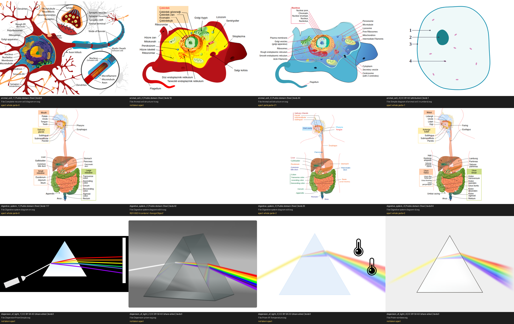
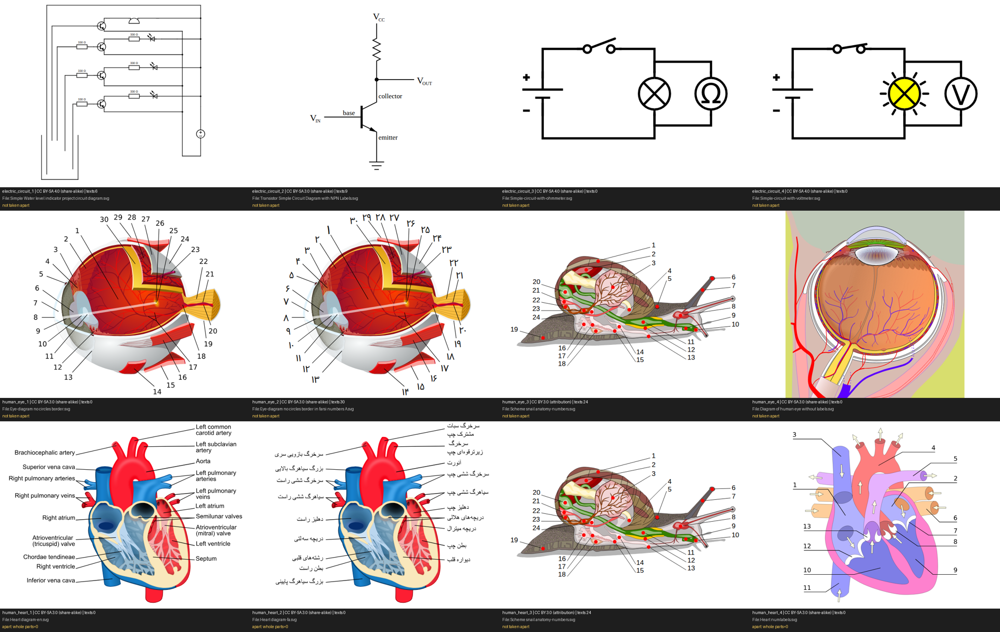
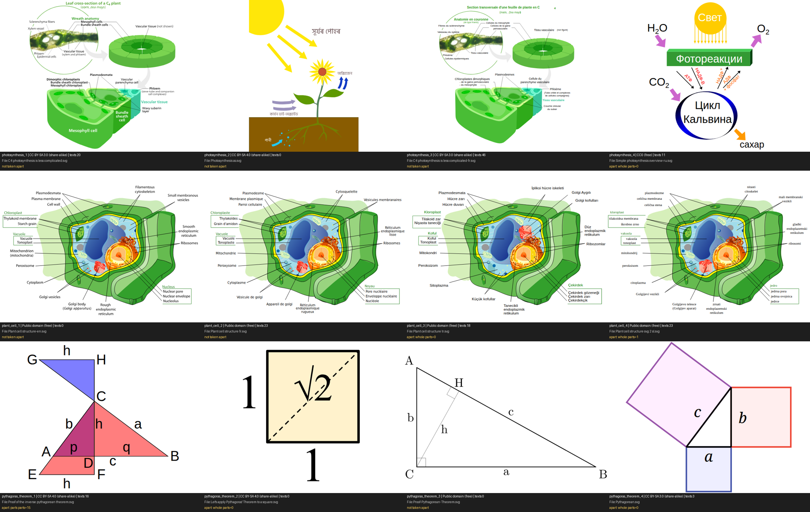
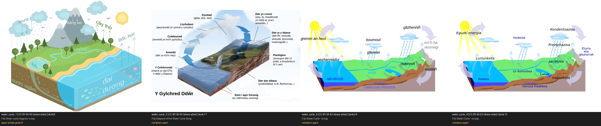
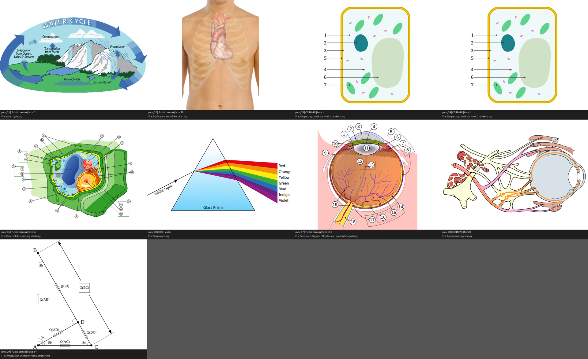

# 09 — Free, open-licensed diagrams as a first place to look (survey, 2026-10-10)

The owner asked for "cheaper open-source visuals". A drawing from their own service costs
about 2 cents an ask through their OpenRouter account (doc 08 §10.7) and a model-written
scene about 8; a diagram that already exists under an open licence costs nothing. This is
a survey of what can be had, made with free requests only: no model, no drawing-service
call, nothing added to the lesson path. The other session has the frame and layout half of
the same note.

Scripts and raw results: `lessonforge_workspace/pilot/open_visuals/` (`commons_search.py`,
`take_apart_all.py`, `sheet.py`, `candidates.json`, `taken_apart.json`).

## 1. What was looked at

Wikimedia Commons, through its search API (the engine already has a resolver for Commons
photographs, `engine/assets.py`; this used the same address and user agent, asking for
vector files). Ten school topics, two searches each: **228 SVG files**, each with its
licence and author read from the API's own fields. 49 of them were fetched and every one
was looked at as a browser draws it.

| topic | SVG files found | without share-alike terms | best find, and its licence |
|---|---|---|---|
| animal cell | 28 | 27 | *Animal cell structure en.svg*, public domain: 21 labels with pointer lines, real text |
| plant cell | 25 | 21 | *Plant cell structure-en.svg*, public domain (words drawn as shapes); a lettered version with real text |
| digestive system | 18 | 16 | *Digestive system diagram en.svg*, public domain: 39 labels, real text, several languages in one file |
| human eye | 28 | 3 | *Schematic diagram of the human eye multilingual.svg*, public domain: each part of the eye a named layer, labels in 22 languages |
| water cycle | 15 | 5 | *Water cycle.svg*, public domain, English (words drawn as shapes) |
| dispersion of light | 15 | 1 | *Dispersions.svg*, CC0: prism, white light, seven named colours, real text |
| pythagoras theorem | 27 | 8 | proof figures, public domain; the squares-on-the-sides figure is CC BY-SA |
| human heart | 29 | 5 | the labelled English one (*Heart diagram-en.svg*) is CC BY-SA 3.0; nothing as good without share-alike |
| electric circuit | 15 | 4 | cell, switch and bulb (*Simple-circuit-with-voltmeter.svg*) is CC BY-SA 4.0; the free ones are block diagrams |
| photosynthesis | 28 | 3 | nothing usable for a school lesson in the first results (a C4 leaf section, a Russian scheme, an Assamese drawing) |






Nine more, picked from the list for having no share-alike terms:



## 2. What is good

- **Biology is covered by textbook-quality drawings in the public domain.** The cell
  diagrams and the digestive system (one illustrator's series, released to the public
  domain) are better drawn than anything a lesson has shown so far, and their labels are
  real text with pointer lines.
- **Some files are built the way a lesson wants.** The eye diagram keeps each part of the
  eye (lens, retina, cornea and sclera, vessels) on a layer of its own with the part's name,
  and a separate label layer per language: 22 of them, Punjabi and Tamil among them (no
  Hindi). Parts that can be lit one at a time and labels that can be switched come with
  the file. The digestive system carries several languages in one file the same way
  (Malayalam and Basque beside English in the copy fetched).
- **The licence can be read by a program.** Every file's licence name, its author and
  whether credit is required came back from the API. Of the 228: 68 public domain or CC0,
  25 CC BY (credit required), 135 share-alike, none non-commercial.

## 3. What goes wrong

- **The search returns wrong things with good titles.** First result for "animal cell": a
  neuron. Among the first four for "human eye" AND for "human heart": the anatomy of a
  snail. For "simple electric circuit": a transistor amplifier and a water-level alarm.
  Doc 07 found the same with photographs. Nothing from a search can be shown unchecked.
- **Other languages come first.** All four water cycles fetched by rank were Vietnamese,
  Welsh, Breton and Basque; the good English one was further down. A file's language is in
  its name ("-en", " fr") often enough to sort by, not always.
- **Too advanced.** "Photosynthesis" gives a C4 leaf cross-section before any school
  picture.
- **Share-alike is most of physics and earth science.** The best heart, circuit, prism
  photographs-as-drawings and most water cycles are CC BY-SA. Using one in a lesson very
  likely obliges the lesson video to be shared under the same terms. That is a decision
  for the owner (and a lawyer), not for code.

## 4. Does a Commons file come apart with the reader the lessons already have?

Mostly not, as the reader stands. Of the first 40 fetched, run through
`diagrams.take_apart` unchanged:

| result | files |
|---|---|
| read, and its parts can be pointed at | 2 (the animal cell: 21 labels, all with a part; a Pythagoras proof figure) |
| read, shown whole | 14 |
| "nothing to draw was found" (the drawing sits inside wrapper groups the reader does not open) | 12 |
| refused as "opaque from edge to edge" (a white page rectangle under the drawing) | 9 |
| the browser drew nothing | 2 |
| refused as unsafe (`<foreignObject>`) | 1 |

The reader was written for the owner's drawing service, which writes flat files. What a
Commons adapter needs, each a known thing rather than research: open wrapper groups until
there are several things to draw; drop a full-page background rectangle; choose one
language where a file carries several (`<switch>` or one layer per language); take named
layers as named parts when a file has them; and keep the existing fallbacks (words drawn as
shapes are shown whole, or read by `harness/typeset.py` when they are glyph references).
A look by the small vision model, as for the service's drawings, has to confirm the subject.

## 5. How it could sit in the pipeline

A third source in front of the two that exist, cheapest first:

1. **A checked shelf** (`library/open/`): for each core topic, one or two files a person has
   looked at, with licence, author and address kept beside them. Nothing is searched at
   lesson time; the credit line goes where a drawing's credit already goes.
2. **The owner's drawing service**, as now, for topics the shelf does not have.
3. **A model-written scene**, as now, only when the service has nothing.

A live search of Commons at lesson time is not proposed: §3 is why.

## 6. Questions for the owner

1. May lessons show public-domain, CC0 and CC BY diagrams from Wikimedia Commons, with the
   author's credit on screen for CC BY?
2. Share-alike (CC BY-SA) files: leave them out, or accept the obligation?
3. A shelf of about twenty checked diagrams for the topics lessons are made on most: which
   topics first?

## 7. Other free sources: licence terms (read 2026-10-10; no files fetched or looked at yet)

Read from the web by the other session's research agent; the OpenStax line I checked myself
on the books' own pages, because an earlier draft of this note had it wrong.

| source | what it has | terms as read | for a product given to others |
|---|---|---|---|
| Wikimedia Commons | labelled diagrams (§1 to §4) | per file; the API returns the licence | public domain, CC0, CC BY: yes; share-alike: the owner's call |
| Iconify icon sets | 275,000 SVG icons in 200+ sets | per set: Material Symbols Apache 2.0, Tabler MIT, Phosphor MIT, Lucide ISC | yes, filtered by set licence |
| Noto Emoji, Fluent Emoji | about 3,000 to 3,700 each | Apache 2.0, MIT | yes |
| Health Icons, Kenney | icons, game art | CC0 | yes |
| Servier Medical Art | 3,000+ anatomy and medical drawings, unlabelled | CC BY 4.0, commercial use allowed | yes, with a stored credit line |
| NIH BioArt | 2,000+ science drawings | free including commercial, licence per entry, credit line given; no bulk route stated | yes, one entry at a time |
| Bioicons | 2,829 SVG science icons | per icon (CC0, CC BY, CC BY-SA, MIT, BSD) | yes, filtered per icon |
| Twemoji | emoji | CC BY 4.0 | yes, with credit |
| OpenMoji | emoji | CC BY-SA 4.0 | share-alike: the owner's call |
| **OpenStax** | textbook figures | **CC BY-NC-SA 4.0**, and no use in generative-AI offerings without written permission (checked on the preface pages of College Physics 2e, Biology 2e, Concepts of Biology, Calculus 1 and Chemistry 2e) | **no** |
| PhET | simulations | CC BY 4.0, but its FAQ asks commercial users for an agreement | ask first |
| unDraw | illustrations | no packs, no automated download, no AI use | no |
| NCERT | textbook figures | copyrighted and enforced | no |

Not verified by anyone here: SciDraw (said to be CC BY), Open Peeps (CC0), OpenClipart
(public domain).

Most of these are ART WITHOUT LABELS (icons, anatomy drawings). They suit a picture of a
thing, with the lesson's own labels put on by code; the labelled diagrams are on Commons.

## 8. A third free source the other session found: pictures drawn on the owner's own machine

Not mine and not built into anything; noted here because it changes the ladder in §5. The
owner's ComfyUI install has an Apache-licensed image model (Z-Image-Turbo). Started on one of
the machine's GPUs it draws a text-free illustration in 10 to 15 seconds for nothing. By the
other session's own look at the results: pictures of things and places are good (a
water-cycle landscape, a prism, a child under a blue sky); diagrams and any writing are not
(arrows the wrong way, a bulb glowing in an open circuit, "Evapration"). Its demonstration
and files are in `lessonforge_workspace/pilot/local_visuals/`.

If the owner wants it, the ladder becomes: the checked shelf; the drawing service for
anything with labels, arrows or a method; a picture drawn on the machine for a thing or a
place; and a model-written scene last.

## 9. What the drawing service is asked to return: three groups (2026-10-10)

The owner agreed that their drawing service should return a drawing already sorted into
scenery, arrows and labels, so that nothing on this side has to guess which stroke belongs
to which box of words. Two things were found first.

**The wording of a request does not decide the kind of drawing.** All 35 drawings in the
library, by what came back: 19 typeset (words as outlines, nothing separable), 10 posters
(boxes of words and arrows), 5 older labelled exports, 1 other. Nine of the ten posters are
the water cycle and the tenth is photosynthesis, whatever the words of the request were;
every other topic came back typeset. The service's own `visual_type` does not follow the
kind either (a water cycle is "mechanical_system" as a poster and "geometry_figure"
typeset).

**Asking for the groups in the request does nothing.** Two requests ended with "put the
scenery in a group with id scene, each arrow in a group …, each label box in a group …": the
food chain failed the service's checks twice, and the water cycle came back as the same
poster with no ids at all. So this is a change in the service, not in what is sent to it.

**The shape asked for.** Directly under `<svg>`, in this order:

```xml
<g id="scene">   everything that is scenery (sky, ground, the plant, the Sun)          </g>
<g id="arrows">
  <g data-part="Evaporation">  the arrow, its head, and anything that moves with it    </g>
  <g data-part="Rain">         …                                                       </g>
</g>
<g id="labels">
  <g data-part="Evaporation">  <rect …/> <text>Evaporation</text> <text>The sun heats water</text>  </g>
  <g data-part="Rain">         <rect …/> <text>…</text>                                              </g>
  <g data-part="title">        <rect …/> <text>The water cycle</text>                               </g>
</g>
```

- `data-part` is the label's name and is the same on a label and on its arrows. A label
  may have no arrows. `title` names nothing.
- Words are `<text>`, never outlines: a typeset drawing can only be shown whole.
- A label is a `<rect>` followed by the lines printed inside it.
- No formula, result or summary printed in the drawing (doc 08 §10.6).

**The reader is ready for it** (`diagrams.sorted_groups`, used by `diagrams.read`). A
drawing with those groups is read by what it says: a label's name is its `data-part`, its
arrows are the groups carrying that name and nothing else, the scene is art whatever words
are drawn in it, and the dots run along the strokes inside an arrow's group. A drawing
without them is read as before. Tried on a hand-made drawing of that shape whose boxes'
colours are swapped on purpose (guessing by colour pairs each label with the other's
arrow): scene, two arrow layers and three labels come out right, in a real browser.
