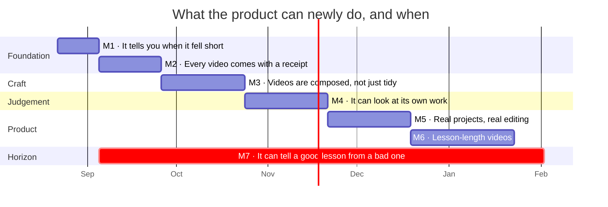

# Product Timeline — what the video engine can do, and what it should be able to do next

**Written 2026-08-22.** This is a capability roadmap, not a task list. Each milestone is
stated as *something a person can do, or trust, that they cannot today* — and each one is
sized by how much of the product changes, not by how many lines of code move.

Companion docs: [`pipeline-roadmap.md`](pipeline-roadmap.md) holds the per-stage engineering
detail and the evidence behind every grade; the [research-problems site](research/problems/index.html)
holds the questions with no known answer. This doc sits above both and answers one
question: **what should we be able to say about this product, in what order?**

---

## 1. What the product does today

You type a school topic. A few minutes later you get a short narrated animated video that
teaches it — Hinglish by default, no human drawing, recording, or editing at any step.

**Today's envelope, stated honestly:**

| | Today |
|---|---|
| **Length** | 90–140 seconds. About four minutes is the ceiling the design allows. |
| **Scope** | One topic, one video. Batches run, but have never been graded on a real multi-topic run. |
| **Visuals** | Manim draws the objects itself — real diagrams and animated systems (a projectile flying, a wave moving), not stock clipart. This is new as of last week and is the biggest recent jump. |
| **Story** | Scenes form an arc around one running example instead of reading like a syllabus. Also new. |
| **Correctness of layout** | Strong. The system measures its own frames for overlapping and cut-off text, repairs what it finds, and never ships a worse version than it started with. |
| **Correctness of *content*** | Unchecked. Nothing verifies that what the narrator says is true to the source, or that the lesson teaches well. |
| **Editing** | A scene-by-scene editor exists. Projects live in the browser and disappear with it. |
| **Cost** | Unknown. The system cannot tell you what a video cost to make. |
| **Judgement** | The system can tell you a frame has overlapping text. It cannot tell you the video is bad. |

**The honest summary:** the engine is good at *making* videos and good at *not breaking
them*. It is not yet able to *account for* them, *judge* them, or *hold a long lesson*.
Those three gaps are the shape of everything below.

---

## 2. The capability ladder

Each milestone depends on the one before it for a reason given below — this is a ladder,
not a menu.

---

### M1 · The system tells you when it fell short
*≈ 2 weeks · foundation*

**What becomes true:** when a video comes out worse than intended, the system says so, in
its own report, before a person watches it. Today a video can come out visibly wrong — a
placeholder where a photo should be, objects at a third of their intended size, an empty
bottom half of the frame — and every internal signal still reads "success".

**Why this is first:** it is not possible to improve anything else honestly without it.
Three of the last live runs were graded as fine by the system and as poor by a human
watching them. Every quality decision after this milestone rests on the machine and the
person agreeing about what happened.

**What it takes:** measurements that follow the work all the way to the finished frame
rather than stopping at the plan; naming, in the report, which of the two rendering paths
actually produced the file; and making the newest capabilities switchable per job, so any
two settings can be compared without restarting the server.

**How we know it landed:** re-run a known topic and the report predicts, without a person
watching, exactly which parts of the video underperformed.

---

### M2 · Every video comes with a receipt, and no work is ever lost
*≈ 3 weeks · foundation · depends on M1*

**What becomes true:** every video carries what it cost to make — the AI calls, the voice
synthesis, the retries — and everything produced along the way survives in one place per
run. A crash stops being a loss; a re-run picks up only what is missing.

**Why this matters more than it sounds:** several of the engine's best new capabilities
(the multi-agent scriptwriting, the object drawing, the visual self-review) are off by
default purely because nobody can price them. This milestone converts "we think that's
expensive" into a number, which is the only basis on which those defaults can change.
It also creates the per-run folder that the editor and long-form videos both need later —
one piece of plumbing, three capabilities.

**What it takes:** the video engine reporting its usage back to the lesson pipeline, which
already keeps a cost ledger it currently cannot fill; jobs that survive a restart; and a
per-run folder holding the script, the code, the frames, the cost, and the finished video.

**How we know it landed:** a killed server comes back knowing what was running, and any
video can answer "what did you cost?"

---

### M3 · Videos are composed, not merely tidy
*≈ 4 weeks · craft · depends on M1*

**What becomes true:** the frame is *designed*. Content sits where the scene's intent says
it should, uses the full frame instead of crowding the top, and each thing on screen
appears at the moment the narrator names it — rather than at a fixed fraction of the way
through the sentence.

**Why this is the biggest visible jump:** today's layout engine is very good at preventing
collisions and blind to meaning. The scriptwriter already describes the intended
composition of every scene in words ("title across the top, the derivation stacked on the
right") — and the renderer reads it, logs it, and ignores it. The intent exists; it just
doesn't reach the part of the system that places things. Narration timing has the same
shape: the mechanism for word-level sync is already present in the toolchain and unused.

**What it takes:** teaching the renderer a small, closed vocabulary of composition
patterns so a scene's stated intent actually steers its layout; pulling under-filled
scenes back to the centre of the frame; and syncing entrances to marked words in the
narration rather than to elapsed time.

**How we know it landed:** the same script, rendered with and without the composition
intent honoured, produces measurably different — and better-balanced — frames.

---

### M4 · The system can look at its own work
*≈ 4 weeks · judgement · depends on M2*

**What becomes true:** the engine reviews its own finished frames the way a person would —
"this frame is empty", "this text is unreadable against the background" — and that
judgement is trustworthy enough to act on. Its repair process also stops being open-ended:
it knows when it is making progress and when it is stuck, and it remembers fixes that
worked before instead of re-deriving each one.

**Why it isn't already true:** all of this is built and switched off. The visual reviewer
was sampling frames at the moments scenes begin — when they are legitimately near-empty —
and called six out of six frames dead. That is a sampling artefact, not perception, but
until it is fixed the reviewer cannot be trusted to veto anything. The repair loop, for
its part, has no theory of when it stalls: some videos still ship with problems it worked
on for four rounds.

**What it takes:** sampling frames where scenes are actually saying something; making
repair work on all flagged scenes in parallel rather than one after another, so the review
is affordable; classifying what the unresolved problems actually are; and switching on the
existing memory of past fixes, carefully enough that a bad memory cannot poison it.

**How we know it landed:** visual review is on by default, with a cost figure that
justifies it, and the number of videos shipping with known unresolved problems falls.

---

### M5 · Real projects, real editing
*≈ 4 weeks · product · depends on M2*

**What becomes true:** a video is a project you keep, reopen from any machine, hand to
someone else, and change a single scene of — with only that scene re-rendering. Edits go
through the same safety checks as freshly generated scripts.

**Why now and not earlier:** the editor already covers the whole loop — brief, script,
per-scene editing, render, progress. What it lacks is durability and granularity, and both
come from the per-run folder built in M2. Building them before M2 would mean building them
twice.

**What it takes:** projects stored on the server rather than in the browser; re-rendering
and re-joining a single changed scene instead of the whole video; and running edited
scripts through the same validation that generated ones already get.

**How we know it landed:** changing one sentence in one scene of a finished video costs
one scene's worth of work, and the project is still there tomorrow, on another machine.

---

### M6 · Lesson-length videos
*≈ 5 weeks · product · depends on M2 and M4*

**What becomes true:** a full lesson — ten to fifteen minutes — instead of a ninety-second
explainer. This is a ten-fold scale-up and the design deliberately does not stretch the
current one: a long video is a sequence of chapters, each of which is a proper short video
with its own arc, threaded by a running summary so terminology and examples stay
consistent across the whole thing.

**Why it comes last:** at ten times the length, everything unmeasured becomes expensive
and everything fragile becomes fatal. Voice synthesis is the dominant cost and needs a
quality gate before it, not after. A single failure must not lose the whole video. Fixing
chapter five should re-make chapter five — which is exactly what M2's per-run folders and
M4's parallel repair buy.

**How we know it landed:** a fifteen-minute lesson generates end-to-end, and a correction
to one chapter costs one chapter.

---

### M7 · It can tell a good lesson from a bad one
*Continuous · horizon · does not block anything*

**What becomes true:** the system scores whether a video *teaches*, not just whether it is
laid out correctly — and that score, not a person's viewing, is what tells us a change was
an improvement.

**Why it is a horizon and not a milestone:** nobody knows how to do this reliably. The
current state is stark — the layout is verified to a high standard, and the teaching is
verified not at all. A pedagogically weak lesson compiles into a pedagogically weak video,
flawlessly. Every one of the last several quality problems was found the same way: a person
watched a finished video and said it was bad. This capability is the difference between
that and catching it before it ships.

It runs continuously alongside everything else, and each phase contributes one piece of
evidence toward it.

---

## 3. Open questions with no known answer

These are the research-grade problems — kept separate from the ladder because they cannot
be scheduled. Each is stated as a capability question. Difficulty follows the
research-problems site: **T2** = shape known, needs experiments · **T3** = no known
reliable solution anywhere.

| Question | T | Why it is genuinely hard |
|---|---|---|
| **Can a machine tell whether a video teaches?** | T3 | A score that predicts *learning* rather than plausibility. Proxy metrics are easy to invent and easy to fool; validating them needs real learners. This is M7. |
| **Can a machine's visual judgement be trusted to block a release?** | T3 | Detecting that a frame looks wrong is easy to demo and hard to calibrate. A reviewer that flags healthy frames is worse than none — it teaches everyone to ignore it. |
| **When does self-repair stop being worth another round?** | T2 | The repair loop improves greedily with no theory of when it stalls, and it is the one place where an AI edits geometry — against this system's own principle that structure belongs to code. Repairing the *plan* rather than the *code* is the promising direction, unproven. |
| **How do you sync animation to code-switched speech?** | T2 | Word-level alignment is a solved problem in English and an open one for Hinglish, where the narration mixes two languages mid-sentence. Affects every timing decision. |
| **When is invention teaching, and when is it hallucination?** | T2 | A good teacher invents an example the source never gave. A bad one invents a number. Both look identical to a fidelity checker. Sources are now citable; the judgement is not. |
| **Can a system remember its own fixes without poisoning itself?** | T2 | A memory of past repairs saves re-deriving each one — and a wrong memory propagates silently and forever. Storing only fixes that *stay* verified is the unsolved half. |
| **Can a verifier be independent of what it verifies?** | T2 | Today, adding a visual capability means blinding the checker — camera movement is deliberately absent for exactly this reason. Every new expressive power currently costs verification coverage. |
| **How should a scene's structure be represented?** | T2 | The system now understands connections and containment, but composes a frame by claiming regions one at a time. Whether a whole-frame solver does better is a real question with a real prototype cost. |

**The through-line:** every one of these sits where one of this system's three ownerships
runs out of road — *models own content, code owns structure, probes own truth*. Content is
ungated, structure isn't meaning, and truth beyond geometry is unowned.

---

## 4. What this timeline is committing to

1. **Honest before impressive.** A capability that cannot be measured does not ship on by
   default, however good it looks in a demo.
2. **Never lose verified work.** Every improvement pass is a candidate: accepted only if it
   is better, and the previous version is never discarded until it is.
3. **Structure belongs to code; content belongs to the models.** A fix that solves a layout
   problem by rewording a prompt is the wrong fix.
4. **One capability, one place.** When two parts of the system decide the same thing, they
   will eventually disagree — and the older one silently wins. Merge them instead.
5. **Judge by watching, not by reading the plan.** Every recent quality failure looked
   correct in the data and wrong on screen.

---

## 5. For engineers — where each milestone lives

| Milestone | Roadmap sections | Research problems |
|---|---|---|
| M1 · Tells you when it fell short | §3d, §3e (open items), §G | P03 |
| M2 · Receipt + durable runs | §H (rows 5, 7, 19) | P02 |
| M3 · Composed, not merely tidy | §B, §D (rows 11, 27, 28) | P05, P06, P11 |
| M4 · Looks at its own work | §F, §G (rows 8, 14, 17) | P03, P04, P07, P10 |
| M5 · Real projects | §J (row 22) | — |
| M6 · Lesson-length | §6, §I (rows 4, 10, 20) | — |
| M7 · Tells good from bad | §A, §G (row 25) | P01, P08, P09 |

`pipeline-roadmap.md` remains the source of truth for grades, evidence, and per-stage
detail; when it and this doc disagree, it wins. New ideas go into its existing entries —
merge, don't add a twin — and reach this doc only once they are a capability someone can
name.
