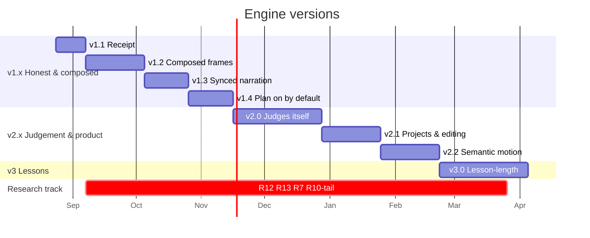

# Research Agenda — the open problems in the flow, who is working on them, and the version plan

**Written 2026-08-22.** Companion to [`problem-decomposition.md`](problem-decomposition.md)
(which maps the problem space and grades the code). This document does three things:

1. **Lists the research problems in the flow**, sectioned by the act of the pipeline they
   live in, each tied to the decomposition's sub-problem number.
2. **Says who is working on each one and how** — from a literature sweep of 2024–2026 work
   (116 papers/tools/APIs — links from the sweep, vendor docs opened 2026-08-22; the full table is
   [`research-papers.csv`](research-papers.csv), one row per item, filterable by cluster,
   problem tag, relevance and maturity).
3. **Lays out a version timeline** for improving the system, each version with a goal, the
   work, the research it draws on, and the number that says it landed.

The sweep was done 2026-08-22; "no active work found" is stated where that is the honest
answer. Numbers quoted from papers are the papers' own.

---

## 0. The headline findings from the sweep

- **Three independent 2026 systems converged on the same architecture as ours** — a
  storyboard IR compiled to Manim with a critic: **OmniManim** (keyframe bboxes + pixel
  diagnostics + numeric acceptance thresholds), **LASEV** (Baidu; deterministic compile,
  >1M videos/day at $0.056 per 2-min video, 96.4% production success) and **Code2Video**
  (anchor-grid critic, ICML 2026). Only OmniManim publishes acceptance thresholds
  (`L_coll ≤ 0.02, L_rel ≤ 0.15, L_bound ≤ 0.01`), and **nobody publishes an
  accept-only-if-violations-fall rule with asset-preservation guards** — our repair loop is
  a differentiator worth writing up.
- **Deterministic geometric checks beat VLM critics for layout.** AeSlides replaced VLM
  reflection with verifiable geometric rewards (collisions −43%, whitespace −44%, human
  score 3.31→3.56); TheoremExplainBench's human correlations show a VLM judge is usable
  for *visual relevance* (ρ 0.72), weak for *layout* (0.42) and noise for *pedagogy*
  (0.14–0.17). Our probe is the right primitive; extend it before re-enabling the VLM.
- **The stopping theory we lack exists now**: VRR-Stop (Jul 2026) formalises
  verify/repair/stop under noisy verifiers; the Debugging Decay Index shows models lose
  60–80% of repair capability within 2–3 attempts; "How Many Tries" shows two rounds
  capture 76–95% of the gain. Round 3 should be a fresh regeneration.
- **Hinglish alignment is solved enough for bookmarks**: MFA with a code-mixed acoustic
  model reaches **4.15 ms** mean boundary error (Jul 2026) — far inside any bookmark
  tolerance; MMS' aligner consumes *romanised* text natively; Azure TTS emits per-word
  offsets for hi-IN voices with no aligner at all.
- **Narration–animation sync is almost unaddressed in research** (LASEV's `wait(T)`
  padding, MINARD's region grounding, and a Mar-2026 speech-synced whiteboard paper are the
  only attempts) — and Omni-Judge shows it cannot be *judged* automatically yet (τ 0.14).
  It has to be measured deterministically (bookmark-hit).
- **The LLM-names-relations / solver-places split we want for layout has a 2026
  instance** (Feynman writes Penrose programs; the solver places) and a relation
  vocabulary in Bluefish (Align / Distribute / Arrow / Background) and ReLayout
  (region / salient / margin). Nobody pairs an LLM with Cassowary/ELK specifically for
  animated scenes.
- **Unclaimed territory** (no active work found): separating pedagogical invention
  (analogies, worked examples) from hallucination; continuous (swept-path) collision
  verification of animated layouts; a bounded per-element `build/animate` contract inside a
  code-owned scene.

---

## 1. The problems, sectioned by act

Tier: **T1** answer known · **T2** shape known, needs experiments · **T3** no reliable
solution anywhere. "Ours" = the decomposition's sub-problem.

| # | Research problem | Act | Ours | Tier | Who is on it (top 3) |
|---|---|---|---|---|---|
| R1 | Quality score for generated explainer video that tracks human judgement | IV/×-cut | 6.1 | T2→T3 | TheoremExplainBench · Code2Video TeachQuiz · EduIllustrate |
| R2 | Calibrating a vision critic so it can gate a release | IV | 4.16 | T3 | VIABLE · PRISM (Adobe) · MLLM-as-UI-Judge |
| R3 | When to stop repairing; repair the plan not the code | IV | 4.17 | T2 | VRR-Stop · DDI · OmniManim |
| R4 | Remembering fixes without poisoning | IV | 4.17 | T2 | ExpeRepair · ManimAgent · Faulty-Memories |
| R5 | Composing a frame (balance, fill, rows/columns), not just de-colliding it | II | 4.10 | T2 | Penrose/Feynman · Bluefish · Visual Moment Equilibrium |
| R6 | Honouring composition intent written as prose | II | 4.10 | T1 | DeepSlides · Code2Video anchors · ReLayout |
| R7 | Verifying layouts across animation time | II/IV | 4.16 | T2 | SGA · ALGOGEN · PRISM-spatiotemporal |
| R8 | Drawings that resemble their subject, verified | II | 4.9 | T2 | OmniDiagram VIVA · VFIG · SimuScene questions |
| R9 | Systems that evolve with the narration (multi-cue simulations) | III | 4.12 | T2 | SimuScene · LASEV · (no bounded-contract work) |
| R10 | Word-synced entrances in code-switched Hinglish | III | 4.14 | T2 | MFA code-mixed · Azure WordBoundary · manim-voiceover bookmarks |
| R11 | Pacing for a grade band | III | 4.3/4.14 | T2 | Mayer · JCAL 2026 · LLM2Manim |
| R12 | Narration fidelity to sources; invention vs hallucination | I | 4.2 | T2 | MiniCheck · conformal citation guard · FaithLens |
| R13 | Does the lesson teach? (pedagogy lints → learner outcomes) | I | 4.3 | T3 | SciEval · Hauk & Soujon · LearnLM |
| R14 | Plan-with-contracts and measured coverage per screen | I | 4.5 | T1 | LASEV script · DeepSlides plan · (no coverage metric in the literature) |
| R15 | Lesson-length by chapterisation with consistent terminology | I/×-cut | 4.1/6.3 | T1 | DOC · EntityBench · LLM2Manim symbol ledger |
| R16 | Human-in-the-loop editing over the IR, incremental regeneration | ×-cut | 4.19 | T1 | Script2Screen · Shiksha Copilot · SketchDynamics |
| R17 | Cost accounting and cost-aware routing under retries | ×-cut | 6.4 | T1 | InflationAgent · UCCI · FrugalGPT/RouteLLM |
| R18 | Grounding for Indian curricula (NCERT) | I | 4.2 | T1 | Shiksha Copilot · IndiMathQA |

---

## 2. Act I — Semantic (what is true, worth teaching, in which words)

### R12 · Narration fidelity to sources; invention vs hallucination — *ours 4.2*

**Who and how.**
- **MiniCheck / LLM-AggreFact** (UT Austin, EMNLP 2024; still the default cheap verifier
  in 2026) — a 770M Flan-T5 (or 7B) entails each sentence against source chunks at
  ~1/400 of GPT-4 cost. [arXiv 2404.10774](https://arxiv.org/abs/2404.10774) ·
  [code](https://github.com/Liyan06/MiniCheck)
- **Citation-faithfulness conformal guard** (Goo et al., Jul 2026) — verifiers disagree
  most on *unsupported* claims (negative-specific agreement 0.27–0.30); a split-conformal
  threshold gives a finite-sample bound (0.94 recall on supported).
  [arXiv 2607.20527](https://arxiv.org/abs/2607.20527)
- **FaithLens** (Dec 2025) splits *faithful-to-source* from *factually-true* — the
  nearest framing to "invention vs hallucination".
  [arXiv 2512.20182](https://arxiv.org/pdf/2512.20182)
- **No active work found** that formally separates pedagogical invention (an analogy, a
  clean worked example) from fabrication; EDM 2024 work counts all unsupported content as
  hallucination (>23% in LLM feedback).

**What to take.** Tag each narration claim {fact, analogy, worked-example} first; run
MiniCheck only on `fact` against the ResearchPack chunks; report "N of M facts traced".
The tagger is the unclaimed research piece.

### R13 · Does the lesson teach? — *ours 4.3, 6.1*

**Who and how.**
- **Hauk & Soujon** (Computers & Education: AI 2026) — o1 vs expert coding of 32 lesson
  plans: reliable on *explicit components* ("objective stated", "terms defined"),
  unreliable on coherence/rationale.
  [sciencedirect](https://www.sciencedirect.com/science/article/pii/S2666920X2500178X)
- **SciEval** (AIED 2026) — 273 lesson materials, 3,549 expert evaluations, 13 EQuIP
  criteria; models predict score + *evidence span*; fine-tuned Qwen3 +11%.
  [arXiv 2604.25472](https://arxiv.org/abs/2604.25472)
- **LearnLM** (Google) — 25-item pedagogy rubric rated by ≥3 educators per turn; +31% expert
  preference vs GPT-4o; the AI-augmented-textbook follow-up shows +5.5 pp on novel problems
  with LearnLM tutoring. [arXiv 2412.16429](https://arxiv.org/abs/2412.16429) ·
  [2505.24477](https://arxiv.org/abs/2505.24477)
- **LLM2Manim** (Apr 2026) — the only Manim-generation paper with a learner study:
  100-student A/B, 83% vs 78% post-test, d = 0.67.
  [arXiv 2604.05266](https://arxiv.org/abs/2604.05266)
- **TeachQuiz / Teach2Eval** — learning-gain proxies using a *model* as the student
  (unlearn → watch → quiz). [Code2Video](https://arxiv.org/abs/2510.01174) ·
  [Teach2Eval](https://arxiv.org/abs/2505.12259)

**What to take.** Build the lints the literature says are reliable (law stated, terms
before use, question answered, evidence span cited) and leave "is it good teaching" to a
learner study designed like LLM2Manim's. TeachQuiz is the cheap proxy to trend between
studies.

### R14 · Plan with contracts; measured coverage — *ours 4.5*

**Who and how.**
- **LASEV** (Baidu, KDD 2026) — an *Executable Video Script* S = (content, narration
  segments, alignment rules) is the plan and the compile input; three critics gate
  release. [arXiv 2602.11790](https://arxiv.org/abs/2602.11790)
- **DeepSlides — "Design First, Code Later"** (Shanghai AI Lab, May 2026) — an explicit
  layered design plan before any code; a 0.6B model reaches 86% with it.
  [arXiv 2605.26451](https://arxiv.org/html/2605.26451)
- **Code2Video** — per-section storyboard with lecture lines *paired* to animations.
- **Film/storyboard agents** (MovieAgent, FilmAgent, 2025) produce shot hierarchies but
  **no plan-coverage metric** was found anywhere — our `coverage()` is ahead of the
  literature here.

**What to take.** The plan as a separate, reviewable artifact is now standard; the
countable `must_show/must_say` contract is ours to keep and publish.

### R15 · Lesson-length by chapterisation — *ours 4.1, 6.3*

**Who and how.**
- **DOC** (ACL 2023) — detailed hierarchical outline conditioned throughout: coherence
  +22.5%, outline relevance +28.2%. [arXiv 2212.10077](https://arxiv.org/abs/2212.10077)
- **Dynamic Hierarchical Outlining + memory** (Dec 2024) and **StoryWriter** (CIKM 2025)
  — the running summary as a structured memory.
  [arXiv 2412.13575](https://arxiv.org/abs/2412.13575)
- **EntityBench** (May 2026) — per-shot *entity schedules* and a verified entity memory
  for long multi-shot video; 140 episodes / 2,491 shots.
  [arXiv 2605.15199](https://arxiv.org/abs/2605.15199)
- **LLM2Manim's symbol ledger** — cross-scene terminology consistency, with learner
  evidence.
- **Long generated lectures**: PresentAgent (outline → slides → narration), Paper2Video,
  ResearchStudio-Reel (MSR, Jul 2026); NotebookLM Video Overviews (Explainer/Brief formats)
  — no published planning details.

**What to take.** Chapter outline decides length once (DOC); a per-chapter entity/term
schedule (EntityBench) makes "the anchor appears in every scene" a checkable list.

### R18 · Grounding for Indian curricula — *ours 4.2*

- **Shiksha Copilot** (Microsoft Research India, 2025) — RAG over state curriculum →
  LLM draft → human curators → teachers; deployed in Karnataka grades 5–10, English +
  Kannada. [arXiv 2507.00456](https://arxiv.org/html/2507.00456)
- **IndiMathQA** (AAAI 2025) — 598 NCERT grade 10–12 problems in Hindi + English.
  [arXiv 2412.18415](https://arxiv.org/html/2412.18415)

**What to take.** A curator step before spend (Shiksha's shape) and an NCERT-aligned
test set for fidelity checks.

---

## 3. Act II — Presentational (what appears, where, looking like what)

### R5 · Composing a frame — *ours 4.10*

**Who and how.**
- **Penrose + Minkowski Penalties** (CMU, TOG 2020 / SIGGRAPH 2024) — constraints as
  differentiable penalties (contain, tangency, padding, non-overlap) for arbitrary shapes.
  [penrose](https://penrose.cs.cmu.edu/siggraph20) ·
  [code](https://github.com/penrose/penrose)
- **Feynman** (Mar 2026) — an LLM writes Penrose programs; the solver places; 100k
  diagram–caption pairs (Diagramma). [arXiv 2603.12597](https://arxiv.org/pdf/2603.12597)
- **Bluefish** (MIT, UIST 2024) — relations Align / Distribute / Arrow / Background over
  a scenegraph. [arXiv 2307.00146](https://arxiv.org/html/2307.00146v3)
- **sPyTial / CnD** (Brown PLT, PACMPL 2026) — orientation / cyclic / group primitives
  refining a default graph layout. [doi](https://doi.org/10.1145/3808275)
- **Visual Moment Equilibrium** (Symmetry, Dec 2025) — balance as moment equilibrium;
  a ~30-line scorer over element bboxes. [doi](https://doi.org/10.3390/sym18010041)
- **ReLayout / LaySPA (Adobe)** — relations as first-class model output; reward =
  geometric validity + relational coherence + aesthetics.
  [2507.05568](https://arxiv.org/abs/2507.05568) · [2602.13912](https://arxiv.org/abs/2602.13912)
- **ELK** (layered/force/radial/box) is the production engine for the "other layout
  kinds"; **ALGOGEN** (May 2026) exposes the layout kind as an LLM-selectable enum.
  [ELK](https://eclipse.dev/elk/) · [ALGOGEN](https://arxiv.org/html/2605.12159)

**What to take.** (1) A balance/white-space scorer first (it is the yardstick for
everything else). (2) Bluefish's Align/Distribute as the `row`/`column` relations. (3) A
layout-kind enum on `connects` graphs backed by ELK. (4) Only then a solver — Feynman
shows the division of labour works.

### R6 · Honouring composition intent — *ours 4.10 (T1)*

DeepSlides and Code2Video both make the plan/anchor-grid *structured* and consume it.
Our `composition` is prose consumed by a log line. Closed vocabulary → template/zone
pre-claims (P05's keyword map) is the cheapest move on this list.

### R7 · Layouts across animation time — *ours 4.16*

- **SGA** (KAUST, Jul 2026) — instruments `construct()` statement by statement, samples
  11 frames per animation, **ignores transient mid-trajectory overlaps**, repairs only
  persistent resting-frame violations; MVQS scalar score; +16.1% on Code2Video.
  [arXiv 2607.18116](https://arxiv.org/html/2607.18116)
- **ALGOGEN** — collision-free by construction from traces.
- **No work found** verifying *continuous* swept-path collisions over a full timeline.

**What to take.** SGA's resting-vs-transient distinction is the decision our per-`play`
probe lacks; sample mid-transition under its own class before counting it.

### R8 · Drawings that resemble their subject — *ours 4.9*

- **OmniDiagram VIVA** (ACL 2026 Findings) — reward = ask targeted visual questions of
  the render and check them. [arXiv 2604.05514](https://arxiv.org/abs/2604.05514)
- **VFIG** — four-axis rubric (presence / layout / connectivity / details) for generated
  figures. [arXiv 2603.24575](https://arxiv.org/pdf/2603.24575)
- **DiagramEval** (UIUC) — diagram ≙ graph; node/path alignment metrics — a
  `connects`-graph-vs-render checker. [arXiv 2510.25761](https://arxiv.org/pdf/2510.25761)
- **VectorGym** (ServiceNow, 2026) — human-validated VLM judge for SVG tasks.

**What to take.** Generate 2–3 yes/no questions per drawing description at `sim_gen`
time; answer them with the vision stage; accept on majority — the same protocol SimuScene
validated at 86.9% human agreement.

---

## 4. Act III — Temporal (when things happen; voice)

### R10 · Word-synced entrances in Hinglish — *ours 4.14*

**Who and how.**
- **Pandey, Gogoi, Tang** (Jul 2026) — MFA acoustic model trained on sentence-level
  code-mixed Hindi-English: **4.15 ms** mean boundary error vs 38.18 ms (Hindi-only) and
  37.58 ms (English-only). [arXiv 2607.25581](https://arxiv.org/abs/2607.25581)
- **MMS forced aligner** (Meta; torchaudio `MMS_FA`) — CTC alignment over *romanised*
  text (uroman) for 1000+ languages; lower resolution than MFA but zero training and it
  consumes Latin-script Hinglish as-is. [ctc-forced-aligner](https://github.com/MahmoudAshraf97/ctc-forced-aligner)
- **Azure Speech TTS** — `WordBoundary` (audioOffset in 100-ns units) and
  `BookmarkReached` events for neural voices incl. hi-IN; no aligner needed.
  [docs](https://learn.microsoft.com/en-us/azure/ai-services/speech-service/speech-synthesis-markup-structure)
- **ElevenLabs** — `with-timestamps` returns character alignment (multilingual_v2 covers
  Hindi) plus a forced-alignment endpoint.
  [docs](https://elevenlabs.io/docs/api-reference/text-to-speech/convert-with-timestamps)
- **Sarvam Bulbul v3** — best-fit Hinglish voice (code-mixing at model level); **no TTS
  word timestamps found** in its docs → pair with MMS/MFA.
  [docs](https://docs.sarvam.ai/api-reference-docs/models/bulbul)
- **manim-voiceover bookmarks** — `<bookmark mark='x'/>` + `tracker.time_until_bookmark()`;
  word boundaries from the service (Azure) or Whisper transcription. Already a dependency;
  our transpiler imports `remove_bookmarks` and never emits a bookmark.
  [docs](https://voiceover.manim.community/en/stable/api.html)
- **Speech-synchronized whiteboard generation** (Mar 2026) — strokes scheduled against
  speech from a structured drawing representation. [arXiv 2603.25870](https://arxiv.org/pdf/2603.25870)
- **Omni-Judge** — automatic sync judging correlates τ 0.14 with humans → measure sync
  deterministically. [arXiv 2602.01623](https://arxiv.org/html/2602.01623)

**What to take.** Bookmarks in cue text (one IR field); word times from Azure when that
voice is used, else MMS over the romanised cue text against the cached clip (no
re-billing); `bookmark_hit_ms` and `dead_air_s` in the sidecar.

### R11 · Pacing — *ours 4.3 / 4.14*

Mayer's segmenting / temporal-contiguity principles remain the computable targets; a
Mar-2026 JCAL study re-confirms temporal contiguity in a 12-min system-paced lesson;
Guo, Kim & Rubin's ~6-min engagement finding still governs chapter length. No 2025–26
empirical wpm-by-grade table was found — our grade-band wpm table stays an assumption to
test in the learner study.

### R9 · Systems that evolve with the narration — *ours 4.12*

**SimuScene** (MBZUAI, Feb 2026) verifies generated simulations with per-scenario yes/no
questions (86.9% human agreement; best model only 21.5% Avg@8 — the task is hard).
**LASEV** syncs by computed `wait(T)`. **No work found** on a bounded per-element
`build/animate` contract inside a code-owned scene — that is ours. Next step is
parameter events so one simulation evolves across cues.

---

## 5. Act IV — Realisation & verification

### R1 · A quality score that tracks human judgement — *ours 6.1*

- **TheoremExplainBench** (ACL 2025) — the only published human-correlation table for
  Manim videos: Visual Relevance ρ 0.72, Element Layout 0.42, Accuracy & Depth 0.14,
  Logical Flow 0.16. [arXiv 2502.19400](https://arxiv.org/abs/2502.19400)
- **EduIllustrate** (Apr 2026) — 8-dim rubric, ρ ≥ 0.83 on *objective* dimensions vs 20
  experts, weak on subjective visual. [arXiv 2604.05005](https://arxiv.org/pdf/2604.05005)
- **LASEV** — 0/1/2/3 release rubric, 3 teachers, 85% unanimous.
- **Code2Video TeachQuiz** — model-as-student learning gain.
- **Reliability without Validity** (Jun 2026) — report κ and bias, never raw agreement.
  [arXiv 2606.19544](https://arxiv.org/abs/2606.19544)

**What to take.** A scorecard split into objective (judge-able: relevance, coverage,
fidelity, geometry, sync) and subjective (human-only) fields, calibrated once on ~20 of
our own videos with κ reported.

### R2 · Calibrating a vision critic — *ours 4.16*

- **VIABLE** (May 2026) — planted-fault protocol; best judge 52.6% single-fault accuracy,
  94.2% self-preference. [arXiv 2605.31351](https://arxiv.org/abs/2605.31351)
- **PRISM (Adobe, Jun 2026)** — 100k perturbed designs each isolating one violation;
  small VLMs barely notice. [arXiv 2606.00592](https://arxiv.org/pdf/2606.00592)
- **MLLM as a UI Judge** (Adobe, Oct 2025) — pairwise accuracy ~60% overall, 93% when
  the gap is large. [arXiv 2510.08783](https://arxiv.org/abs/2510.08783)
- **AeSlides** — geometric rewards beat VLM reflection.
  [arXiv 2604.22840](https://arxiv.org/abs/2604.22840)
- **Weak-verifier aggregation** (Stanford, Jun 2026) — LLM-written verifier programs in
  a layout DSL, aggregated: 7× F1 over direct judging.
  [arXiv 2606.05268](https://arxiv.org/pdf/2606.05268)

**What to take.** Plant known faults in our own renders; measure recall/FPR per class;
let the VLM gate only large deltas; grow deterministic checks (weak-verifier style)
before trusting perception.

### R3 · Stopping, and repairing the plan — *ours 4.17*

- **VRR-Stop** (Jul 2026) — verifier FA/FR + repairer model → commit when marginal gain
  ≤ 0; +60.6 pts vs fixed 5 rounds. [arXiv 2607.17641](https://arxiv.org/abs/2607.17641)
- **Debugging Decay Index** (Sci. Reports 2025) — 60–80% of repair capability lost in
  2–3 attempts; fresh start at the inflection. [arXiv 2506.18403](https://arxiv.org/abs/2506.18403)
- **How Many Tries** (Apr 2026) — two rounds = 76–95% of the gain; logic errors repair at
  ~45%. [arXiv 2604.10508](https://arxiv.org/abs/2604.10508)
- **Blind resampling beats self-repair below 7B** (Jul 2026) — don't show a small model
  the failed script. [arXiv 2607.26117](https://arxiv.org/abs/2607.26117)
- **OmniManim** — localized repair routed to the *responsible agent*, one round, numeric
  thresholds. **Code2Video ScopeRefine** — line → block → section escalation.
- **Paper2Video** — enumerate variants (scale × font) → render → pick; no LLM nudging.

**What to take.** Round 1–2 repair, round 3 regenerate the scene; classify residues;
for scale/font violations enumerate-and-pick instead of rewriting; route layout residues
to an IR re-solve once R5 exists.

### R4 · Repair memory — *ours 4.17*

ExpeRepair (FSE 2026: demonstrations + insights), ManimAgent (Jun 2026: verified
successes as soft exemplars, failures as hard pitfalls), and "From Faulty Memories to
Corrected Actions" (Aug 2026: rollback). Store only pairs that *stayed* verified; keep a
rollback path.

---

## 6. Cross-cutting

### R16 · Human-in-the-loop editing over the IR — *ours 4.19*
Script2Screen (incremental audiovisual regeneration from script edits), Shiksha Copilot
(curator step before teachers), SketchDynamics (CHI 2026, sketch storyboard → intent),
Textual-to-Visual Self-Verification (render before review). Pattern: edit the plan,
re-render the changed unit.

### R17 · Cost under retries — *ours 6.4*
**InflationAgent** (Aug 2026): per-call price understates agentic cost >2× (4.25× for
7B); escalate *fresh* (forwarding failed chains costs up to −34.8 pts). **UCCI**:
calibrated escalation (−31% cost at F1 0.91). Our receipt must meter retries per stage.

---

## 7. Benchmarks to regress against (all free)

| Benchmark | What it tests | Size | Source |
|---|---|---|---|
| TheoremExplainBench | end-to-end Manim explainers, 5 VLM dims | 240 theorems | [2502.19400](https://arxiv.org/abs/2502.19400) |
| EduRequire-500 / ManimLayout-1K | layout from requirements; keyframe GT bboxes | 500 / 22.6k keyframes | [2605.15585](https://arxiv.org/abs/2605.15585) |
| MMMC (Code2Video) | code-centric video gen, TeachQuiz | — | [2510.01174](https://arxiv.org/abs/2510.01174) |
| ManimBench-v1 | description→code pairs | 417 | [HF](https://huggingface.co/datasets/SuienR/ManimBench-v1) |
| ManiBench | API version conflicts, visual-logic drift | 12 → 150 | [2603.13251](https://arxiv.org/html/2603.13251) |
| SimuScene test | verified simulation questions | 334 | [2602.10840](https://arxiv.org/abs/2602.10840) |
| Diagramma | diagram–caption pairs (Penrose) | 100k | [2603.12597](https://arxiv.org/pdf/2603.12597) |
| EduIllustrate | K-12 text+diagram, 8-dim rubric | 230 | [2604.05005](https://arxiv.org/pdf/2604.05005) |
| HiACC | Hinglish adult + children speech | — | [PMC](https://www.ncbi.nlm.nih.gov/pmc/articles/PMC12329218/) |
| IndiMathQA | NCERT grade 10–12 math | 598 | [2412.18415](https://arxiv.org/html/2412.18415) |

---

## 8. The version timeline

Versions, not milestones: each is a shippable state of the engine with a name, a
two-line promise, the work, the research it leans on, and the **exit number**. Dates
assume a start on 2026-08-24, one engineer, research reading folded into the version
that uses it. Earlier docs' M1–M7 map onto these (M1→v1.1, M2→v1.1/1.2, M3→v1.3/1.4,
M4→v2.0, M5→v2.1, M6→v3.0, M7→research track).

### v1.1 — "Receipt" · 2 weeks · 2026-08-24 → 09-06
**Promise.** Every run has one folder and a cost; every sidecar says how long the video
is, which renderer made it, and what survived.
- Per-run folder (board, plan, scripts, clips, frames, `cost.json`, final mp4); jobs
  persisted; stale detection.
- Usage reported per LLM/TTS call incl. **retries** (InflationAgent) and cache hits at
  would-have-cost; unknown ≠ 0.
- Sidecar gains `rendered_duration_s`, `render_path`, `elements_declared/degraded`,
  `shape_overlaps` counted, `dead_air_s` (placeholder).
- Planted-fault fixture set (10 scenes × known fault) — the calibration bed every later
  version uses (PRISM/VIABLE protocol).
- Resolve the empty `.tts_cache/` finding.
**Research used.** R17. **Exit.** Any two runs comparable by cost and duration; a killed
server resumes; `voice_degraded`/`cost` read sane on a known-good run.

### v1.2 — "Composed frames" · 4 weeks · 09-07 → 10-04
**Promise.** Frames are balanced and full, composition intent is honoured, and the probe
sees what the audits found.
- Balance + white-space scorer per scene (Visual Moment Equilibrium; 2410.08885
  white-space formula) logged for every render → then a whole-frame centring/fill pass
  behind a flag.
- `composition` keyword map → template/zone pre-claims (R6).
- `row` / `column` relations (Bluefish Align/Distribute) → `VGroup.arrange`; schema
  `--regen`.
- Layout-kind enum on `connects` graphs (ALGOGEN) backed by ELK for radial/flow.
- Probe: count shape-on-shape; text-over-image by centre-in-bbox; mid-transition sampling
  under SGA's resting-vs-transient rule.
- Regress on ManimLayout-1K / EduRequire-500.
**Research used.** R5, R6, R7. **Exit.** Vertical-centroid and white-space numbers move
on the 08-15 projectile board; 0 new violations on the planted set; A/B with and without
the composition map differs measurably.

### v1.3 — "Synced narration" · 3 weeks · 10-05 → 10-25
**Promise.** Each thing appears when the narrator names it; nothing is re-billed.
- `<bookmark>` marks in cue text (one IR field + `--regen`); transpiler waits on them.
- Word times: Azure `WordBoundary` when that voice is used; otherwise MMS aligner over
  the romanised cue against the cached clip (no re-synthesis); MFA code-mixed model if
  obtainable (4.15 ms).
- `bookmark_hit_ms` and `dead_air_s` in the sidecar.
- Script critic before synthesis (LASEV's narration critic shape): double-speak, filler,
  read-aloud quality — text-only edits, beat count fixed.
**Research used.** R10, R11. **Exit.** Median bookmark hit ≤ 300 ms on 10 videos;
`dead_air_s` falls vs v1.2; TTS calls per video unchanged.

### v1.4 — "Plan on by default" · 3 weeks · 10-26 → 11-15
**Promise.** The screen plan is the artifact a person reviews; thin screens are fixed, not
logged.
- `DEEP_STORYBOARD=1` default once v1.1 prices it; plan shown and editable in Studio
  before fan-out; single-screen rewrite when `coverage()` under-delivers; recap floor.
- Pedagogy lints (Hauk & Soujon's reliable set): law stated, terms before use, hook
  answered, evidence span cited.
- Fidelity spot-check v0: claim tagger {fact, analogy, example} + MiniCheck on facts
  against the ResearchPack → "N of M traced" in the sidecar.
**Research used.** R12, R13, R14. **Exit.** Coverage gap = 0 on the 08-15 board; lints
catch the Dalton board; fidelity number reads ~100% on a sourced topic and lower on an
unsourced one.

### v2.0 — "Judges itself" · 6 weeks · 11-16 → 12-27
**Promise.** The engine grades each video on a scorecard that agrees with people, repairs
with a stopping rule, and remembers fixes safely.
- Scorecard sidecar: objective dims (geometry, balance, coverage, fidelity, sync,
  relevance) + subjective left blank; calibrated on 20 own videos, κ reported.
- Vision QA re-enabled *after* planted-fault recall/FPR per class; gates only large
  deltas; frames sampled at scene midpoints.
- Repair: VRR-style stop (probe FA/FR from the planted set), round 3 = fresh scene
  regeneration (DDI), enumerate-and-pick for scale/font, residue classifier, flagged
  scenes rewritten in parallel.
- Fix memory on, verified-only, with rollback.
- TeachQuiz-style proxy trended per commit via the bulk runner on a fixed 10-topic suite.
**Research used.** R1–R4. **Exit.** Scorecard κ ≥ 0.5 on objective dims; share of videos
shipping with residual violations falls from 50%; vision FPR < 10% on planted set.

### v2.1 — "Projects & editing" · 4 weeks · 12-28 → 2027-01-24
Server-side projects on the per-run folder; gate-validated PATCH; per-scene re-render +
re-join; edit-the-plan-then-regenerate (Script2Screen). **Exit.** One-sentence edit costs
one scene; project survives a machine change.

### v2.2 — "Semantic motion" · 4 weeks · 01-25 → 02-21
Simulations driven across cues (parameter events); SimuScene-style verification questions
per simulation; VFIG/VIVA resemblance questions per drawing; trace/counter verbs in the
Motion Director. **Exit.** Resemblance pass rate reported; a wave changes frequency as the
narration does, and the probe stays clean.

### v3.0 — "Lesson-length" · 6 weeks · 02-22 → 04-04
Chapter outline decides length (DOC); per-chapter entity/term schedule (EntityBench,
LLM2Manim ledger); running summary as structured memory; chapter manifest on the bulk
runner; script gate mandatory; xfade at assembly. **Exit.** A 12–15 min lesson end to end;
a chapter-5 fix re-makes chapter 5; terminology consistency measured across chapters.

### Research track (runs alongside; no version depends on finishing it)
- **R12 tail** — invention-vs-hallucination tagger; validate against teachers.
- **R13 tail** — learner study in LLM2Manim's design (≥100 students, post-test), once
  v2.0's scorecard exists to correlate with.
- **R7 tail** — continuous swept-path collision verification; a frame-aware probe that
  would unblock camera moves.
- **R10 tail** — code-switched alignment on children's speech (HiACC); wpm-by-grade
  evidence.
- **Write-up** — the accept-if-better + preservation-guard repair contract and the
  countable screen plan are publishable contributions nobody else reports.

---

## 9. How to use the CSV

[`research-papers.csv`](research-papers.csv) — one row per paper/tool/API (116).
Columns: `id, cluster, relevance, maturity, year, title, authors, venue, problem_tags,
pipeline_shape, representation, verification, key_numbers, datasets_released,
reusable_for_us, url, code_url, notes`. Filter `relevance=high` for the ~40 that change a
decision here; `problem_tags` uses the vocabulary in this doc (layout-verification,
self-repair, narration-sync, fidelity, …). Rows marked `notes: link-verified` were opened;
vendor-doc rows are current as of 2026-08-22.
